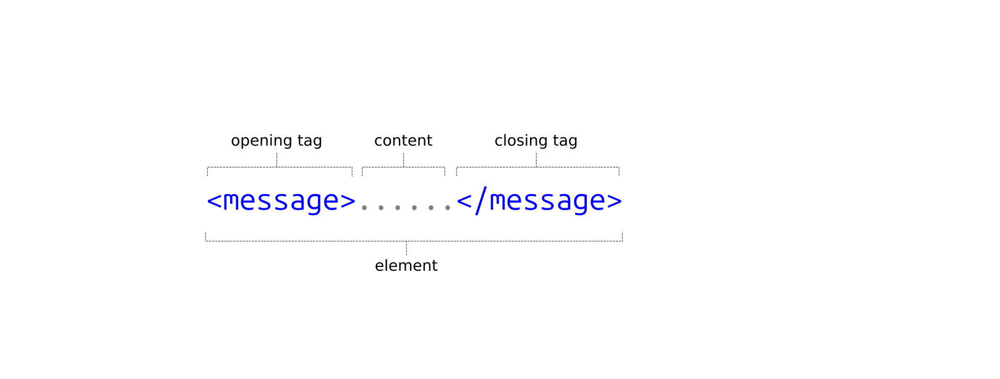
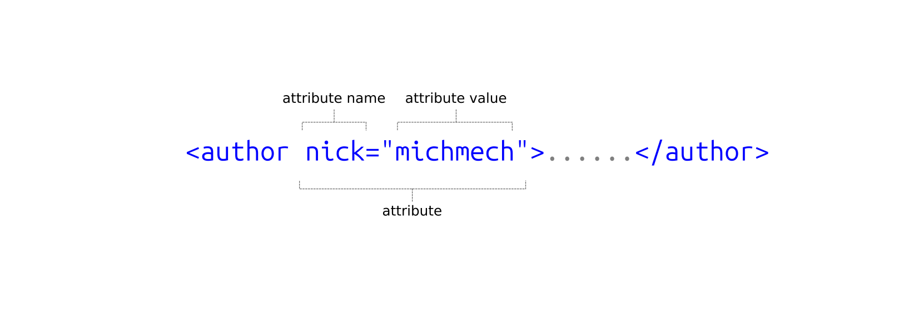
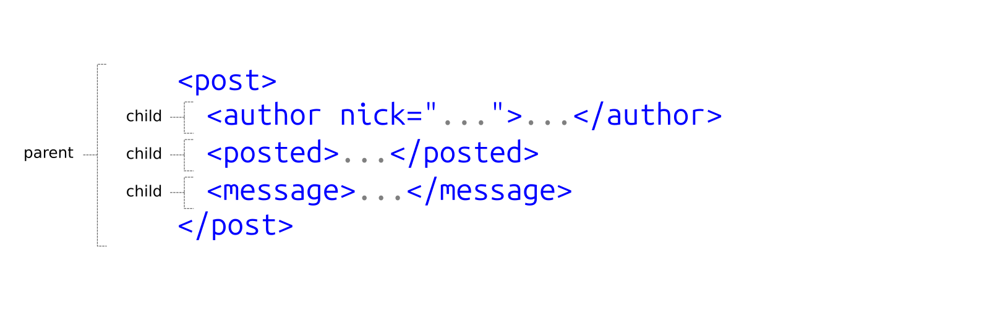
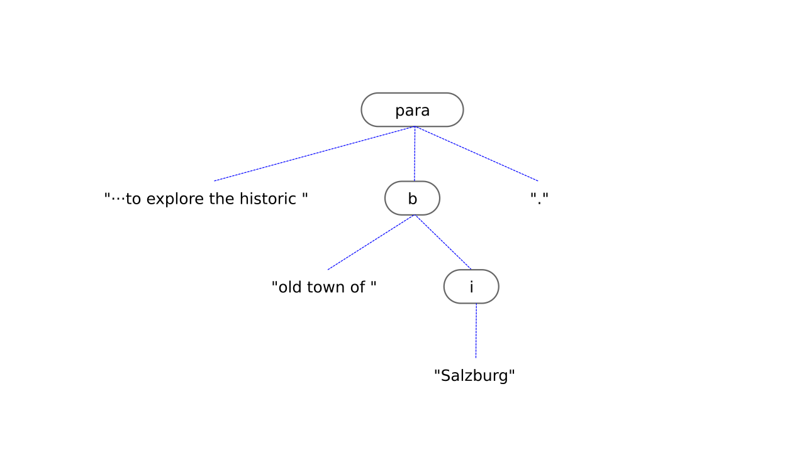

340088-1 VO Sprachtechnologien, Informations- und Interfacedesign  
Information management lecture 1
# Formats for structuring text: from plain text to XML

---
## We are here
0. Introductory lecture <!--{.element class="grey"}-->

Foundational technologies

1. (LT1) How computers represent characters: ASCII, Unicode and everything in between <!--{.element class="grey"}-->
2. (LT2) Working with text: going above the level of character encoding <!--{.element class="grey"}-->
    <div>(LT2A) From spellcheckers to AI writing assistants</div>
3. <span class="hilite">**(IM1) Formats for structuring text: from plain text to XML**</span>
4. (IM2) Managing data: JSON, YAML, relational databases, Semantic Web.

A dive into NLP and AI

5. (LT3) Intro to Natural Language Processing (NLP): tagging, parsing and their applications
6. (LT4) Understanding the technology behind NLP: language models, vectors, word embeddings
7. (LT5) Large Language Models (LLMs): understanding how they do what they do

Multilingual software

8. (UI1) Understanding user interfaces: what designing a good user experience is about
9. (UI2) Software localisation and globalisation: the challenge of translating on-screen text
10. (IM3) Understanding Internet technology: how the Internet works under the hood
11. (UI3) Managing multilingual websites: pitfalls to avoid on the multilingual web

---
## Plan for today
- Plain text
- Adding structure and/or formatting to plain text  
  - Markdown
  - LaTeX
  - XML
    - Popular XML schemas:  
      Open Document Format, Office Open XML, DocBook, TEI, (HTML)
    - XML schemas common in the language industry:  
      TMX, TBX, XLIFF

---
## What is plain text?
- A sequence of Unicode codepoints *only*
  - No formatting: no italics, no bold etc.
  - No explicit structure: is this a heading, a subheading, a bulletted list...?
  - No information about language

---
## What isn't plain text?
- A Microsoft Word document
- A Google Docs document
- etc.

---
## How do you edit plain text?
- The file usually has the extension `.txt`
- Most operating systems have an app for editing plain text files.
  - Windows: Notepad
  - Ubuntu Linux: GNOME Text Editor
- All programming code (eg. code in Python, in JavaScript...) is also plain text.
  - Programmers use specialised code editors.

---
## What is the opposite of plain text?
- "Rich text", "formatted text", "structured text"

---
## Markdown

---
## The syntax of Markdown

```
# Weekend Trip to Salzburg

We are planning a **three-day getaway** to explore the historic old town of *Salzburg*.
The weather forecast predicts light rain, so we need to pack accordingly. 

Remember to check the [Salzburg Tourism Board](https://salzburg.info)
for any last-minute event updates or scheduling changes.

## To-Do List Before Leaving

- Book the train tickets online.
- Confirm the hotel check-in time.
- Water the apartment plants.
```

---
## Output from Markdown

> # Weekend Trip to Salzburg
> 
> We are planning a **three-day getaway** to explore the historic old town of *Salzburg*. The weather forecast predicts
> light rain, so we need to pack accordingly. 
> 
> Remember to check the [Salzburg Tourism Board](https://salzburg.info) for any last-minute event updates or scheduling changes.
> 
> ## To-Do List Before Leaving
> 
> - Book the train tickets online.
> - Confirm the hotel check-in time.
> - Water the apartment plants.

---
## Working with Markdown
- You can use any plain text editor
- Many specialised Markdown editors exist (eg. [Obsidian](https://obsidian.md/))
  - Syntax highlighting
  - Keyboard shortcuts
  - Export to PDF, HTML...

---
## What is Markdown used for?
- Popular for technical documentation
- LLMs like Markdown!

---
## What else do you need to know about Markdown?
- Created by John Gruber in 2004
- Not strictly standardised, many different flavours exist
  - [Github-Flavoured Markdown](https://github.blog/engineering/user-experience/a-formal-spec-for-github-markdown/) (GFM)
  - [CommonMark](https://commonmark.org/)
  - etc.

---
## Markdown competitors
- [reStructuredText](https://docutils.sourceforge.io/rst.html)
- [AsciiDoc](https://asciidoc.org/)
- etc.

---
## LaTeX

---
## The syntax of LaTeX

```
\begin{document}

\section{Weekend Trip to Salzburg}

We are planning a quick \textbf{three-day getaway) to explore the historic old town
of \textit{Salzburg}. The weather forecast predicts light rain, so we need to pack accordingly. 

Remember to check the \href{https://salzburg.info}{Salzburg Tourism Board} for any
last-minute event updates or scheduling changes.

\subsection{To-Do List Before Leaving}

\begin{itemize}
    \item Book the train tickets online.
    \item Confirm the hotel check-in time.
    \item Water the apartment plants.
\end{itemize}

\end{document}
```

---
## Output from LaTeX

> # Weekend Trip to Salzburg
> 
> We are planning a **three-day getaway** to explore the historic old town of *Salzburg*. The weather forecast predicts
> light rain, so we need to pack accordingly. 
> 
> Remember to check the [Salzburg Tourism Board](https://salzburg.info) for any last-minute event updates or scheduling changes.
> 
> ## To-Do List Before Leaving
> 
> - Book the train tickets online.
> - Confirm the hotel check-in time.
> - Water the apartment plants.

---
## Working with LaTeX
- Complex tooling
  - Installing/managing plug-ins etc.
  - Producing PDFs 
- Specialised LaTeX editors exist (eg. [Overleaf](https://www.overleaf.com/))
  - Syntax highlighting
  - Keyboard shortcuts
  - Export to PDF, HTML...

---
## What is LaTeX used for?
- Popular for scientific publications

---
## What else do you need to know about LaTeX?
- LaTeX: created by Leslie Lamport in 1984
  - TeX: ceated by Donald Knuth in 1978
- Not strictly standardised
  - Community-driven

---
## XML (Extensible Markup Language)

---
## What Markdown doesn't give you 
- Custom inline markup
  - Names of people, placenames, dates, times...
- Non-typical content types 
  - Theatrical plays, dictionary entries, parallel bilingual text...

---
## The syntax of XML

```
<article>
    <title>Weekend Trip to Salzburg</title>

    <paragraph>
      We are planning a quick <bold>three-day getaway</bold> to explore the historic old town
      of <italic>Salzburg</italic>. The weather forecast predicts light rain, so we need to
      pack accordingly.
    </paragraph>

    <paragraph>
      Remember to check the <link url="https://salzburg.info">Salzburg Tourism Board</link> 
      for any last-minute event updates or scheduling changes.
    </paragraph>

    <subtitle>To-Do List Before Leaving</subtitle>

    <list type="bulletted">
      <item>Book the train tickets online.</item>
      <item>Confirm the hotel check-in time.</item>
      <item>Water the apartment plants.</item>
    </list>
</article>
```

---
## The syntax of XML

```
<document>
    <heading>Weekend Trip to Salzburg</heading>

    <para>
      We are planning a quick <b>three-day getaway</b> to explore the historic old town
      of <i>Salzburg</i>. The weather forecast predicts light rain, so we need to
      pack accordingly.
    </para>

    <para>
      Remember to check the <hyperlink taget="https://salzburg.info">Salzburg Tourism Board
      </hyperlink> for any last-minute event updates or scheduling changes.
    </para>

    <subheading>To-Do List Before Leaving</subheading>

    <bullettedList>
      <listItem>Book the train tickets online.</listItem>
      <listItem>Confirm the hotel check-in time.</listItem>
      <listItem>Water the apartment plants.</listItem>
    </bullettedList>
</document>
```

---
## Custom inline markup

```
<biography>
  James MacAdam (1801–1861), manufacturer and geologist,
  was born in High Street, Belfast, the first child and
  the elder of two surviving sons of James MacAdam
  (1775–1821), merchant, and Jane MacAdam (née Shipboy)
  (1774–1827), a Belfast native. Two siblings died in
  infancy while a...
</biography>
```

---
## Custom inline markup

```
<biography>
  <person>James MacAdam</person> (1801–1861), manufacturer and geologist,
  was born in High Street, Belfast, the first child and
  the elder of two surviving sons of <person>James MacAdam</person>
  (1775–1821), merchant, and <person>Jane MacAdam (née Shipboy)</person>
  (1774–1827), a Belfast native. Two siblings died in
  infancy while a...
</biography>
```

---
## Custom inline markup

```
<biography>
  <person id="5634">James MacAdam</person> (1801–1861), manufacturer and geologist,
  was born in High Street, Belfast, the first child and
  the elder of two surviving sons of <person id="6542">James MacAdam</person>
  (1775–1821), merchant, and <person id="9832">Jane MacAdam (née Shipboy)</person>
  (1774–1827), a Belfast native. Two siblings died in
  infancy while a...
</biography>
```

---
## Custom inline markup

```
<biography>
  <person id="5634">James MacAdam</person> (1801–1861), manufacturer and geologist,
  was born in High Street, <place id="BLF">Belfast</place>, the first child and
  the elder of two surviving sons of <person id="6542">James MacAdam</person>
  (1775–1821), merchant, and <person id="9832">Jane MacAdam (née Shipboy)</person>
  (1774–1827), a Belfast native. Two siblings died in
  infancy while a...
</biography>
```

---
## Non-typical content

> **Taylor:** Is this it?  
> **Sam** *(Without looking up):* Depends what you're looking for.  
> **Taylor** *(Sighs, drops backpack with a heavy thud):* How long have you been here?  
> **Sam:** Time gets slippery under fluorescent lights.

---
## Non-typical content

```
<play>
  <turn>
    <character>Taylor</character>
    <speech>Is this it?</speech>
  <turn>
  <turn>
    <character>Sam</character>
    <action>Without looking up</action>
    <speech>Depends what you're looking for.</speech>
  <turn>
  <turn>
    <character>Taylor</character>
    <action>Sighs, drops backpack with a heavy thud</action>
    <speech>How long have you been here?</speech>
  <turn>
  <turn>
    <character>Sam</character>
    <speech>Time gets slippery under fluorescent lights.</speech>
  <turn>
</play>
```

---
Think about this
## How would you represent an e-mail message in XML?

---
## An e-mail message in XML (1/3)

```
<message>
  <from>michal.mechura@univie.ac.at</from>
  <to>dragos.ciobanu@univie.ac.at</to>
  <to>miguel.rios@univie.ac.at</to>
  <subject>Weekend Trip to Salzburg</subject>
  <body>
    <para>
      We are planning a quick <b>three-day getaway</b> to explore the historic old town
      of <i>Salzburg</i>. The weather forecast predicts light rain, so we need to pack
      accordingly.
    </para>
    <para>
      Remember to check the <hyperlink taget="https://salzburg.info">Salzburg Tourism
      Board</hyperlink> for any last-minute event updates or scheduling changes.
    </para>
  </body>
</message>
```

---
## An e-mail message in XML (1/3)

```
<message>
  <from>michal.mechura@univie.ac.at</from>
  <to>dragos.ciobanu@univie.ac.at</to>
  <to>miguel.rios@univie.ac.at</to>
  ·
  ·
  ·
</message>
```

---
## An e-mail message in XML (3/3)

```
<message>
  <from>
    <email>michal.mechura@univie.ac.at</email>
    <displayName>Michal Mechura</displayName>
  </from>
  <to>
    <email>dragos.ciobanu@univie.ac.at</email>
    <displayName>Dragos Ciobanu</displayName>
  </to>
  <to>
    <email>miguel.rios@univie.ac.at</email>
    <displayName>Miguel Rios</displayName>
  </to>
  ·
  ·
  ·
</message>
```

---
## An e-mail message in XML (2/3)

```
<message>
  <from email="michal.mechura@univie.ac.at">Michal Mechura</from>
  <to email="dragos.ciobanu@univie.ac.at">Dragos Ciobanu</to>
  <to email="miguel.rios@univie.ac.at">Miguel Rios</to>
  ·
  ·
  ·
</message>
```


---
Think about this
## How would you represent a threaded discussion in XML?

---
## A threaded discussion XML (1/2)

```
<post>
  <author nick="michmech">Michal Měchura</author>
  <posted>2026-10-03 09:32:08</posted>
  <message>Just found there is a street in Vienna called Computerstraße!</message>
</post>
```

---
## A threaded discussion XML (1/2)

```
<post>
  <author nick="michmech">Michal Měchura</author>
  <posted>2026-10-03 09:32:08</posted>
  <message>Just found there is a street in Vienna called Computerstraße!</message>
  <post>
    <author nick="king">Dennis King</author>
    <posted>2026-10-03 09:50:01</posted>
    <message>I hope they also have a Programmiererstraße!</message>
  </post>
</post>
```

---
## A threaded discussion XML (1/2)

```
<post>
  <author nick="michmech">Michal Měchura</author>
  <posted>2026-10-03 09:32:08</posted>
  <message>Just found there is a street in Vienna called Computerstraße!</message>
  <post>
    <author nick="king">Dennis King</author>
    <posted>2026-10-03 09:50:01</posted>
    <message>I hope they also have a Programmiererstraße!</message>
  </post>
  <post>
    <author nick="aonghus">Aonghus ó hAlmhain</author>
    <posted>2026-10-03 10:05:33</posted>
    <message>What's the neighbourhood like? Cool or boring?</message>
    </post>
</post>
```

---
## A threaded discussion XML (2/2)

```
<post>
  <author nick="michmech">Michal Měchura</author>
  <posted>2026-10-03 09:32:08</posted>
  <message>Just found there is a street in Vienna called Computerstraße!</message>
  <post>
    <author nick="king">Dennis King</author>
    <posted>2026-10-03 09:50:01</posted>
    <message>I hope they also have a Programmiererstraße!</message>
  </post>
  <post>
    <author nick="aonghus">Aonghus ó hAlmhain</author>
    <posted>2026-10-03 10:05:33</posted>
    <message>What's the neighbourhood like? Cool or boring?</message>
    <post>
      <author nick="michmech">Michal Měchura</author>
      <posted>2026-10-03 11:01:21</posted>
      <message>Boring, I'm afraid. Nothing much besides an office park there.</message>
    </post>
  </post>
</post>
```

---
## The anatomy of XML
 <!--{.element style="width: 100%"}-->

---
## The anatomy of XML
 <!--{.element style="width: 100%"}-->

---
## The anatomy of XML
 <!--{.element style="width: 100%"}-->

---
## The rules of XML
- Element names and attribute names are case-sensitive.
  - `<bold>` versus `<BOLD>`
- Every opening element must have a closing element.
  - `<name>···</name>`
- Every child element must be wholly contained within its parent element. 

---
## No overlapping markup
- Wrong
  ```
  <para>···to explore the historic <b>old town of <i>Salzburg</b></i>.</para>
  ```
- Right
  ```
  <para>···to explore the historic <b>old town of <i>Salzburg</i></b>.</para>
  ```

---
## The tree structure of XML
 <!--{.element style="width: 100%"}-->

---
## XML schema
- Which elements and attributes are allowed to exist
  - How they are allowed to stack inside each other
- Popular schema formalisms:
  - DTD ("Document Type Definition")
  - XSD ("XML Schema Definition")

---
## Well-formed XML, valid XML
- Well-formed XML
  - Conforms to the rules of XML: opening tags paired with closing tags, no overlapping markup...
- Valid XML
  - Conforms to a given schema

---
## The standardisation of XML
- World Wide Web Consortium (W3C)
- Since 1998
- Evolved from SGML (Standard Generalized Markup Language)
  - ISO 8879:1986
- Which evolved from GML (Generalized Markup Language)
  - IBM, 1969

---
## Popular XML schemas for structuring text
- Open Document Format (OpenOffice, LibreOffice)
- Office Open XML (Microsoft Word)
- DocBook
- TEI
- (HTML)

---
## DocBook

```
<book>
  <info>
    <title>The Minimalist Guide to Vienna</title>
  </info>

  <chapter>
    <title>Your first week in Vienna</title>
    <para>This is the first chapter of the book. It introduces...</para>
    <section>
      <title>Finding a place to live</title>
      <para>This is a section explaining how to...</para>
    </section>
  </chapter>

  <chapter>
    <title>Beyond your first week</title>
    <para>This chapter dives deeper into....</para>
  </chapter>
</book>
```

---
## TEI (Text Encoding Initiative)

```
<TEI>
  <teiHeader>
    <fileDesc>
      <titleStmt>
        <title>The Minimalist Guide to Vienna</title>
      </titleStmt>
    </fileDesc>
  </teiHeader>
  <text>
    <body>
      <div type="chapter">
        <head>Your first week in Vienna</head>
        <p>This is the first chapter of the book. It introduces...</p>
        <div type="section">
          <head>Finding a place to live</head>
          <p>This is a section explaining how to...</p>
        </div>
      </div>
      <div type="chapter">
        <head>Beyond your first week</head>
        <p>This chapter dives deeper into...</p>
      </div>
    </body>
  </text>
</TEI>
```

---
## HTML (Hypertext Markup Language)

```
<html lang="en">
  <head>
    <title>My homepage</title>
  </head>
  <body>
    <h1>Welcome to my homepage!</h1>
    <p>This site is work in progress. Come back later.</p>
  </body>
</html>
```

---
## XML schemas common in the language industry
- TMX (Translation Memory Exchange)
- TBX (Termbase Exchange)
- XLIFF (XML Localization Interchange File Format)

---
## TMX (Translation Memory Exchange)

```
<tmx version="1.4">
  <body>
    <tu>
      <tuv xml:lang="en">
        <seg>Hello World!</seg>
      </tuv>
      <tuv xml:lang="de">
        <seg>Hallo, Welt!</seg>
      </tuv>
    </tu>
  </body>
</tmx>
```

---
## TBX (Termbase Exchange)

```
<tbx type="TBX-Basic" style="dca">
  <body>
    <termEntry id="c1">
      <descrip type="definition">
        A biological process for converting
        light energy into chemical energy.
      </descrip>
      <langSet xml:lang="en">
        <tig>
          <term>photosynthesis</term>
          <termNote type="partOfSpeech">noun</termNote>
        </tig>
      </langSet>
      <langSet xml:lang="de">
        <tig>
          <term>Photosynthese</term>
          <termNote type="partOfSpeech">noun</termNote>
          <termNote type="gender">feminine</termNote>
        </tig>
      </langSet>
    </termEntry>
  </body>
</tbx>
```

---
## XLIFF (XML Localization Interchange File Format)

```
<xliff version="2.0" srcLang="en" trgLang="de">
  <file id="f1">
    <unit id="u1">
      <segment>
        <source>File saved successfully.</source>
        <target>Datei erfolgreich gespeichert.</target>
      </segment>
    </unit>
    <unit id="u2">
      <segment>
        <source>Cancel</source>
        <target>Abbrechen</target>
      </segment>
    </unit>
  </file>
</xliff>
```

---
## Plan for today
- Plain text
- Adding structure and/or formatting to plain text  
  - Markdown
  - LaTeX
  - XML
    - Popular XML schemas:  
      Open Document Format, Office Open XML, DocBook, TEI, (HTML)
    - XML schemas common in the language industry:  
      TMX, TBX, XLIFF

---
## Recommended further reading
- Markdown
  - ‘Markdown Tutorial’ https://www.markdowntutorial.com/
  - ‘Markdown Guide’ https://www.markdownguide.org/
- XML
  - ‘A Gentle Introduction to XML’ https://www.tei-c.org/release/doc/tei-p5-doc/en/html/SG.html
  - ‘What is XML and why should humanists care? An even gentler introduction to XML’ https://dh.obdurodon.org/what-is-xml.xhtml

---
## We are here
0. Introductory lecture <!--{.element class="grey"}-->

Foundational technologies

1. (LT1) How computers represent characters: ASCII, Unicode and everything in between <!--{.element class="grey"}-->
2. (LT2) Working with text: going above the level of character encoding <!--{.element class="grey"}-->
    <div>(LT2A) From spellcheckers to AI writing assistants</div>
3. (IM1) Formats for structuring text: from plain text to XML <!--{.element class="grey"}-->
4. (IM2) Managing data: JSON, YAML, relational databases, Semantic Web.

A dive into NLP and AI

5. (LT3) Intro to Natural Language Processing (NLP): tagging, parsing and their applications
6. (LT4) Understanding the technology behind NLP: language models, vectors, word embeddings
7. (LT5) Large Language Models (LLMs): understanding how they do what they do

Multilingual software

8. (UI1) Understanding user interfaces: what designing a good user experience is about
9. (UI2) Software localisation and globalisation: the challenge of translating on-screen text
10. (IM3) Understanding Internet technology: how the Internet works under the hood
11. (UI3) Managing multilingual websites: pitfalls to avoid on the multilingual web

