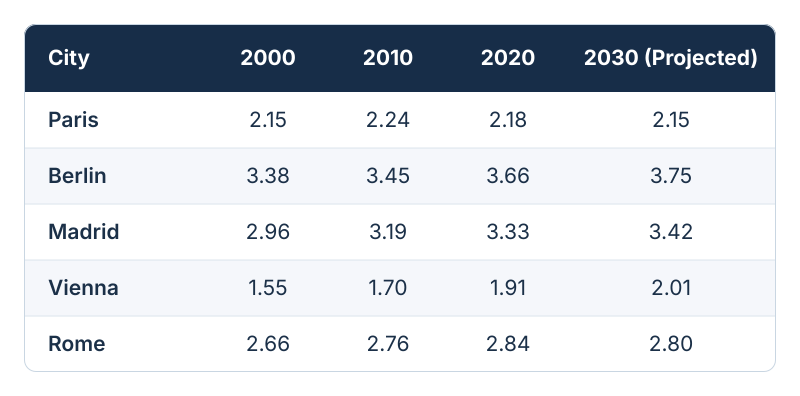
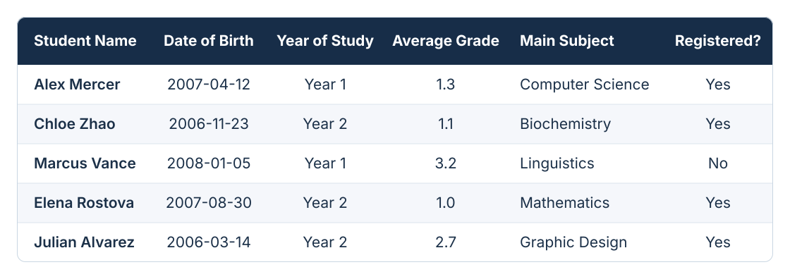
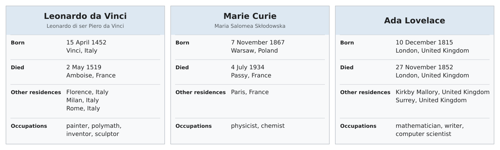
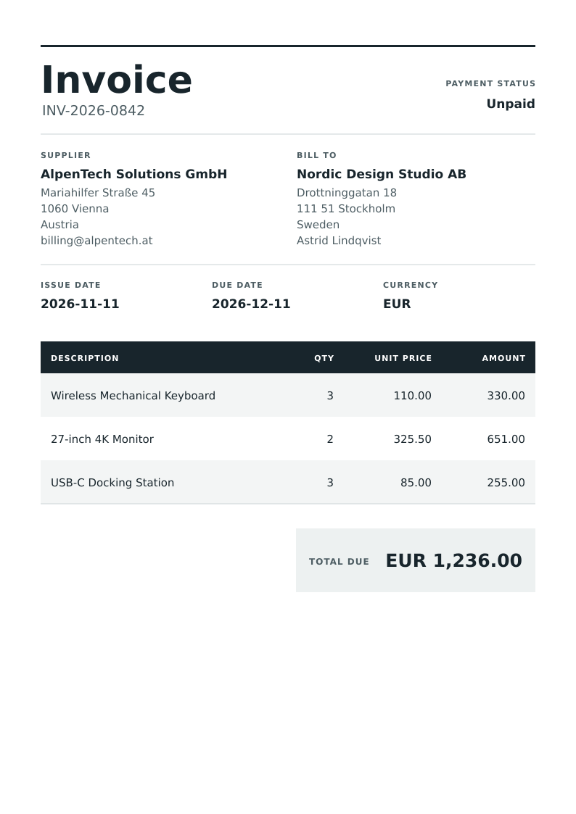
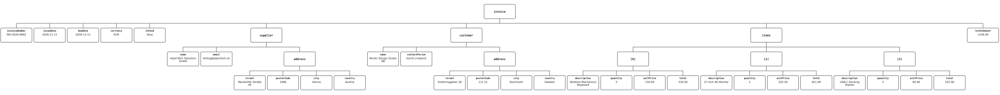
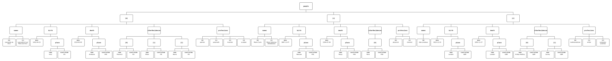
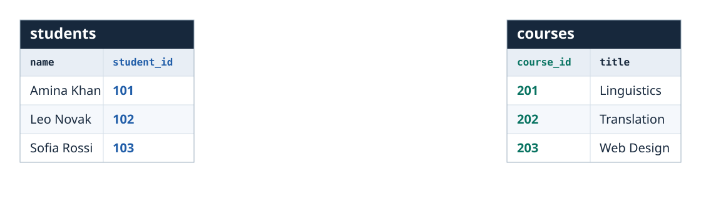
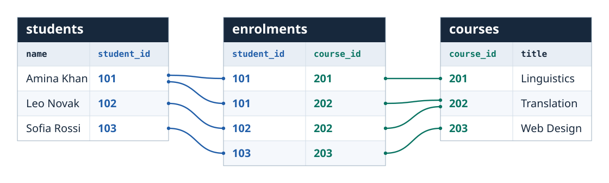
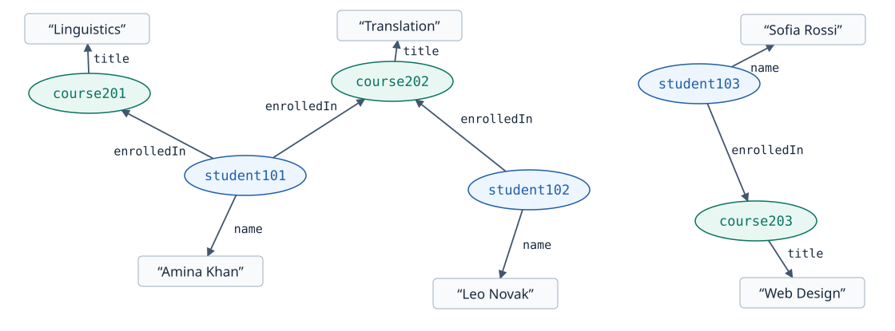
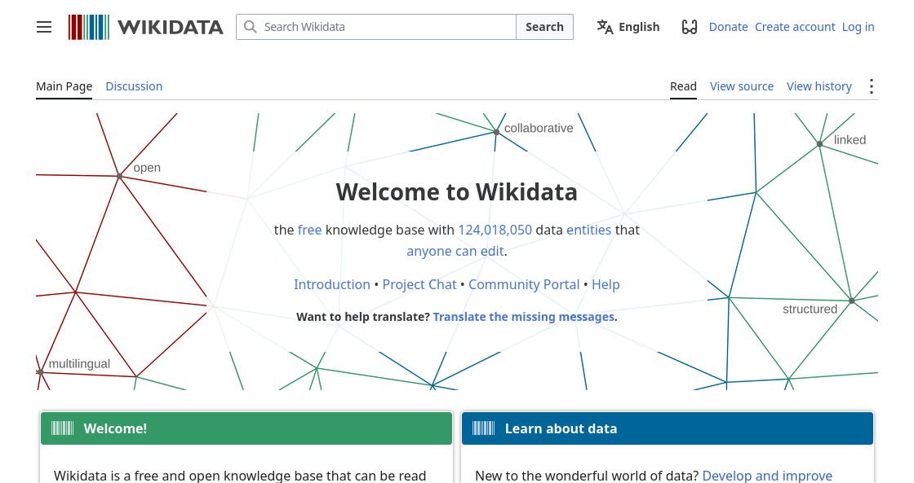

340088-1 VO Sprachtechnologien, Informations- und Interfacedesign  
Information management lecture 2
# Managing data: XML, JSON, YAML, relational databases and knowledge graphs

---
## We are here
0. Introductory lecture <!--{.element class="grey"}-->

Foundational technologies

1. (LT1) How computers represent characters: ASCII, Unicode and everything in between <!--{.element class="grey"}-->
2. (LT2) Working with text: going above the level of character encoding <!--{.element class="grey"}-->
    <div>(LT2A) From spellcheckers to AI writing assistants</div>
3. (IM1) Formats for structuring text: from plain text to XML <!--{.element class="grey"}-->
4. <span class="hilite">**(IM2) Managing data: XML, JSON, YAML, relational databases and knowledge graphs**</span>

A dive into NLP and AI

5. (LT3) Intro to Natural Language Processing (NLP): tagging, parsing and their applications
6. (LT4) Understanding the technology behind NLP: language models, vectors, word embeddings
7. (LT5) Large Language Models (LLMs): understanding how they do what they do

Multilingual software

8. (UI1) Understanding user interfaces: what designing a good user experience is about
9. (UI2) Software localisation and globalisation: the challenge of translating on-screen text
10. (IM3) Understanding Internet technology: how the Internet works under the hood
11. (UI3) Managing multilingual websites: pitfalls to avoid on the multilingual web

---
## Plan for today
1. Two-dimensional tables
    - TSV, CSV
2. Structured data
    - XML, JSON, YAML
3. Relational databases
    - SQL
4. Knowledge graphs
    - Semantic Web, RDF

---
## 1. Two-dimensional tables

---
 <!--{.element style="width: 75%"}-->

---
 <!--{.element style="width: 100%"}-->

---
## Tab-Separated Values (TSV)
cities.tsv
```
City  2000  2010  2020  2030 (Projected)
Paris  2.15  2.24  2.18  2.15
Berlin  3.38  3.45  3.66  3.75
Madrid  2.96  3.19  3.33  3.42
Vienna  1.55  1.70  1.91  2.01
Rome  2.66  2.76  2.84  2.80
```
The tab character: [U+0009 CHARACTER TABULATION](https://unicode-explorer.com/c/0009)

---
## Tab-Separated Values (TSV)
students.tsv
```
Student Name  Date of Birth  Year of Study  Average Grade  Main Subject  Registered?
Alex Mercer  2007-04-12  Year 1  1.3  Computer Science  Yes
Chloe Zhao  2006-11-23  Year 2  1.1  Biochemistry  Yes
Marcus Vance  2008-01-05  Year 1  3.2  Linguistics  No
Elena Rostova  2007-08-30  Year 2  1.0  Mathematics  Yes
Julian Alvarez  2006-03-14  Year 2  2.7  Graphic Design  Yes
```
The tab character: [U+0009 CHARACTER TABULATION](https://unicode-explorer.com/c/0009)

---
## Comma-Separated Values (CSV)
cities.csv
```
City,2000,2010,2020,2030 (Projected)
Paris,2.15,2.24,2.18,2.15
Berlin,3.38,3.45,3.66,3.75
Madrid,2.96,3.19,3.33,3.42
Vienna,1.55,1.70,1.91,2.01
Rome,2.66,2.76,2.84,2.80
```
Comma: [U+002C COMMA](https://unicode-explorer.com/c/002C)

---
## Comma-Separated Values (CSV)
students.csv
```
Student Name,Date of Birth,Year of Study,Average Grade,Main Subject,Registered?
Alex Mercer,2007-04-12,Year 1,1.3,Computer Science,Yes
Chloe Zhao,2006-11-23,Year 2,1.1,Biochemistry,Yes
Marcus Vance,2008-01-05,Year 1,3.2,Linguistics,No
Elena Rostova,2007-08-30,Year 2,1.0,Mathematics,Yes
Julian Alvarez,2006-03-14,Year 2,2.7,Graphic Design,Yes
```
Comma: [U+002C COMMA](https://unicode-explorer.com/c/002C)

---
## Comma-Separated Values (CSV) with quoted strings
students.csv
```
Student Name,Date of Birth,Year of Study,Average Grade,Main Subject,Registered?
Alex Mercer,2007-04-12,Year 1,1.3,Computer Science,Yes
Chloe Zhao,2006-11-23,Year 2,1.1,Biochemistry,Yes
Marcus Vance,2008-01-05,Year 1,3.2,Linguistics,No
Elena Rostova,2007-08-30,Year 2,1.0,"Linguistics, Mathematics",Yes
Julian Alvarez,2006-03-14,Year 2,2.7,Graphic Design,Yes
```

---
## 2. Structured data

---
 <!--{.element style="width: 100%"}-->

---
 <!--{.element style="width: 65%"}-->

---
## Structured data in XML
<!-- .slide: style="height: 100%; overflow-y: auto;" -->
```
<people>
  <person>
    <names>
      <name>Leonardo da Vinci</name>
      <name>Leonardo di ser Piero da Vinci</name>
    </names>
    <birth>
      <date>1452-04-15</date>
      <place>
        <name>Vinci</name>
        <countryCode>ITA</countryCode>
      </place>
    </birth>
    <death>
      <date>1519-05-02</date>
      <place>
        <name>Amboise</name>
        <countryCode>FRA</countryCode>
      </place>
    </death>
    <otherResidences>
      <place>
        <name>Florence</name>
        <countryCode>ITA</countryCode>
      </place>
      <place>
        <name>Milan</name>
        <countryCode>ITA</countryCode>
      </place>
      <place>
        <name>Rome</name>
        <countryCode>ITA</countryCode>
      </place>
    </otherResidences>
    <professions>
      <profession>painter</profession>
      <profession>polymath</profession>
      <profession>inventor</profession>
      <profession>sculptor</profession>
    </professions>
  </person>
  <person>
    <names>
      <name>Marie Curie</name>
      <name>Maria Salomea Skłodowska</name>
    </names>
    <birth>
      <date>1867-11-07</date>
      <place>
        <name>Warsaw</name>
        <countryCode>POL</countryCode>
      </place>
    </birth>
    <death>
      <date>1934-07-04</date>
      <place>
        <name>Passy</name>
        <countryCode>FRA</countryCode>
      </place>
    </death>
    <otherResidences>
      <place>
        <name>Paris</name>
        <countryCode>FRA</countryCode>
      </place>
    </otherResidences>
    <professions>
      <profession>physicist</profession>
      <profession>chemist</profession>
    </professions>
  </person>
  <person>
    <names>
      <name>Ada Lovelace</name>
    </names>
    <birth>
      <date>1815-12-10</date>
      <place>
        <name>London</name>
        <countryCode>GBR</countryCode>
      </place>
    </birth>
    <death>
      <date>1852-11-27</date>
      <place>
        <name>London</name>
        <countryCode>GBR</countryCode>
      </place>
    </death>
    <otherResidences>
      <place>
        <name>Kirkby Mallory</name>
        <countryCode>GBR</countryCode>
      </place>
      <place>
        <name>Surrey</name>
        <countryCode>GBR</countryCode>
      </place>
    </otherResidences>
    <professions>
      <profession>mathematician</profession>
      <profession>writer</profession>
      <profession>computer scientist</profession>
    </professions>
  </person>
</people>
```

---
## Structured data in XML
<!-- .slide: style="height: 100%; overflow-y: auto;" -->
```
<invoice>
  <invoiceNumber>INV-2026-0842</invoiceNumber>
  <issueDate>2026-11-11</issueDate>
  <dueDate>2026-12-11</dueDate>
  <currency>EUR</currency>
  <isPaid>false</isPaid>

  <supplier>
    <name>AlpenTech Solutions GmbH</name>
    <email>billing@alpentech.at</email>
    <address>
      <street>Mariahilfer Straße 45</street>
      <postalCode>1060</postalCode>
      <city>Vienna</city>
      <country>Austria</country>
    </address>
  </supplier>

  <customer>
    <name>Nordic Design Studio AB</name>
    <contactPerson>Astrid Lindqvist</contactPerson>
    <address>
      <street>Drottninggatan 18</street>
      <postalCode>111 51</postalCode>
      <city>Stockholm</city>
      <country>Sweden</country>
    </address>
  </customer>

  <items>
    <item>
      <description>Wireless Mechanical Keyboard</description>
      <quantity>3</quantity>
      <unitPrice>110.00</unitPrice>
      <total>330.00</total>
    </item>
    <item>
      <description>27-inch 4K Monitor</description>
      <quantity>2</quantity>
      <unitPrice>325.50</unitPrice>
      <total>651.00</total>
    </item>
    <item>
      <description>USB-C Docking Station</description>
      <quantity>3</quantity>
      <unitPrice>85.00</unitPrice>
      <total>255.00</total>
    </item>
  </items>

  <totalAmount>1236.00</totalAmount>
</invoice>
```

---
## JSON
- "JavaScript Object Notation"
- Originated from the JavaScript programming language

---
## Structured data in JSON
<!-- .slide: style="height: 100%; overflow-y: auto;" -->
```
{
  "invoiceNumber": "INV-2026-0842",
  "issueDate": "2026-11-11",
  "dueDate": "2026-12-11",
  "currency": "EUR",
  "isPaid": false,
  "supplier": {
    "name": "AlpenTech Solutions GmbH",
    "email": "billing@alpentech.at",
    "address": {
      "street": "Mariahilfer Straße 45",
      "postalCode": "1060",
      "city": "Vienna",
      "country": "Austria"
    }
  },
  "customer": {
    "name": "Nordic Design Studio AB",
    "contactPerson": "Astrid Lindqvist",
    "address": {
      "street": "Drottninggatan 18",
      "postalCode": "111 51",
      "city": "Stockholm",
      "country": "Sweden"
    }
  },
  "items": [
    {
      "description": "Wireless Mechanical Keyboard",
      "quantity": 3,
      "unitPrice": 110.00,
      "total": 330.00
    },
    {
      "description": "27-inch 4K Monitor",
      "quantity": 2,
      "unitPrice": 325.50,
      "total": 651.00
    },
    {
      "description": "USB-C Docking Station",
      "quantity": 3,
      "unitPrice": 85.00,
      "total": 255.00
    }
  ],
  "totalAmount": 1236.00
}
```

---
## Structured data in JSON
<!-- .slide: style="height: 100%; overflow-y: auto;" -->
```
[
  {
    "names": [
      "Leonardo da Vinci",
      "Leonardo di ser Piero da Vinci"
    ],
    "birth": {
      "date": "1452-04-15",
      "place": {
        "name": "Vinci",
        "countryCode": "ITA"
      }
    },
    "death": {
      "date": "1519-05-02",
      "place": {
        "name": "Amboise",
        "countryCode": "FRA"
      }
    },
    "otherResidences": [
      {
        "name": "Florence",
        "countryCode": "ITA"
      },
      {
        "name": "Milan",
        "countryCode": "ITA"
      },
      {
        "name": "Rome",
        "countryCode": "ITA"
      }
    ],
    "professions": [
      "painter",
      "polymath",
      "inventor",
      "sculptor"
    ]
  },
  {
    "names": [
      "Marie Curie",
      "Maria Salomea Skłodowska"
    ],
    "birth": {
      "date": "1867-11-07",
      "place": {
        "name": "Warsaw",
        "countryCode": "POL"
      }
    },
    "death": {
      "date": "1934-07-04",
      "place": {
        "name": "Passy",
        "countryCode": "FRA"
      }
    },
    "otherResidences": [
      {
        "name": "Paris",
        "countryCode": "FRA"
      }
    ],
    "professions": [
      "physicist",
      "chemist"
    ]
  },
  {
    "names": [
      "Ada Lovelace"
    ],
    "birth": {
      "date": "1815-12-10",
      "place": {
        "name": "London",
        "countryCode": "GBR"
      }
    },
    "death": {
      "date": "1852-11-27",
      "place": {
        "name": "London",
        "countryCode": "GBR"
      }
    },
    "otherResidences": [
      {
        "name": "Kirkby Mallory",
        "countryCode": "GBR"
      },
      {
        "name": "Surrey",
        "countryCode": "GBR"
      }
    ],
    "professions": [
      "mathematician",
      "writer",
      "computer scientist"
    ]
  }
]
```

---
## The syntax of JSON
Curly-bracketed *objects* containing *name-value pairs* separated by *commas*
```
{
  "someName": "someValue",
  "someOtherName": "someOtherValue"
}
```

---
## The syntax of JSON
The value can be
- a string of text, a number, a boolean (true/false):
  ```
  "name": "Leonardo da Vinci"
  ```
  ```
  "unitPrice": 325.50
  ```
  ```
  "registered": true
  ```
- an object
  ```
  "birth": {"date": ..., "place": ...}
  ```
- a lists (array) of any of the above
  ```
  "professions": ["painter", "polymath", "inventor", "sculptor"]
  ```
  ```
  "otherResidences": [{"name": ..., "countryCode": ...}, {"name": ..., "countryCode": ...}]
  ```

---
## The syntax of JSON
Whitespace is insignificant
```
"otherResidences": [{"name": ..., "countryCode": ...}, {"name": ..., "countryCode": ...}]
```
```
"otherResidences": [
  {"name": ..., "countryCode": ...},
  {"name": ..., "countryCode": ...}
]
```
```
"otherResidences": [
  {
    "name": ...,
    "countryCode": ...
  },
  {
    "name": ...,
    "countryCode": ...
  }
]
```

---
## The syntax of JSON
Order is insignificant (except in lists/arrays)
```
{
  "name": ...,
  "countryCode": ...
},
```
```
{
  "countryCode": ...,
  "name": ...
},
```


---
## JSON
- Popular alternative to XML for *data*
- Not really suitable for *text* 

---
## YAML
- "Yet Another Markup Language"
- "YAML Ain't a Markup Language"

---
## Structured data in YAML
<!-- .slide: style="height: 100%; overflow-y: auto;" -->

```
invoice:
  invoiceNumber: INV-2026-0842
  issueDate: 2026-11-11
  dueDate: 2026-12-11
  currency: EUR
  isPaid: false
  
  supplier:
    name: AlpenTech Solutions GmbH
    email: billing@alpentech.at
    address:
      street: Mariahilfer Straße 45
      postalCode: 1060
      city: Vienna
      country: Austria
  
  customer:
    name: Nordic Design Studio AB
    contactPerson: Astrid Lindqvist
    address:
      street: Drottninggatan 18
      postalCode: 111 51
      city: Stockholm
      country: Sweden
  
  items:
    - description: Wireless Mechanical Keyboard
      quantity: 3
      unitPrice: 110.00
      total: 330.00
  
    - description: 27-inch 4K Monitor
      quantity: 2
      unitPrice: 325.50
      total: 651.00
  
    - description: USB-C Docking Station
      quantity: 3
      unitPrice: 85.00
      total: 255.00
  
  totalAmount: 1236.00
```

---
## Structured data in YAML
<!-- .slide: style="height: 100%; overflow-y: auto;" -->

```
people:
  - names:
      - Leonardo da Vinci
      - Leonardo di ser Piero da Vinci
    birth:
      date: 1452-04-15
      place:
        name: Vinci
        countryCode: ITA
    death:
      date: 1519-05-02
      place:
        name: Amboise
        countryCode: FRA
    otherResidences:
      - name: Florence
        countryCode: ITA
      - name: Milan
        countryCode: ITA
      - name: Rome
        countryCode: ITA
    professions:
      - painter
      - polymath
      - inventor
      - sculptor

  - names:
      - Marie Curie
      - Maria Salomea Skłodowska
    birth:
      date: 1867-11-07
      place:
        name: Warsaw
        countryCode: POL
    death:
      date: 1934-07-04
      place:
        name: Passy
        countryCode: FRA
    otherResidences:
      - name: Paris
        countryCode: FRA
    professions:
      - physicist
      - chemist

  - names:
      - Ada Lovelace
    birth:
      date: 1815-12-10
      place:
        name: London
        countryCode: GBR
    death:
      date: 1852-11-27
      place:
        name: London
        countryCode: GBR
    otherResidences:
      - name: Kirkby Mallory
        countryCode: GBR
      - name: Surrey
        countryCode: GBR
    professions:
      - mathematician
      - writer
      - computer scientist
```

---
## The syntax of YAML (compared to JSON)
- Name-value pairs
  ```
  name: Paris
  ```
- Indentation instead of curly brackets
  ```
    place:
      name: London
      countryCode: GBR
  ```
- Markdown-like bulleted lists instead of arrays
  ```
  professions:
    - mathematician
    - writer
    - computer scientist
  ```

---
## YAML
- Optimised for human readability/writeability
- A response to the perceived over-complexity of XML and JSON

---
## YAML front matter in Markdown
<!-- .slide: style="height: 100%; overflow-y: auto;" -->

```
  ---
  title: Lemon and mint lemonade recipe
  author: Sam Rivera
  datePublished: 2026-11-12
  draft: false
  tags:
    - drinks
    - summer
  ---

  # Lemon and mint lemonade

  This tart, refreshing lemonade takes about ten minutes to make. Add a
  little more sugar if you like it sweeter.

  ## Ingredients

  - 3 lemons
  - 3 tablespoons of sugar
  - 750 ml of cold water
  - 8 fresh mint leaves
  - Ice, to serve

  ## Method

  1. Squeeze the lemons into a jug and remove any pips.
  2. Stir in the sugar until it dissolves, then add the cold water.
  3. Gently crush the mint leaves between your fingers and drop them into the jug.
  4. Taste, adjust the sweetness if needed, and pour into four glasses over ice.

```

---
## What do XML, JSON and YAML have in common?
They all represent a *tree structure*.

---
<!-- .slide: style="height: 100%; overflow-y: auto;" -->
  <!--{.element style="width: 85%"}-->

---
<!-- .slide: style="height: 100%; overflow-y: auto;" -->
  <!--{.element style="width: 85%"}-->

---
## Can *everything* be represented as a tree structure?

---
## 3. Relational databases

---

<div class="r-stack">

 <!--{.element style="width: 100%"}-->

 <!--{.element class="fragment" style="width: 100%"}-->

</div>

---
## A relational database is...
- Several two-dimensional tables
  - with *relationships* between them

---
## SQL (Structured Query Language)

---
## SQL (Structured Query Language)

 <!--{.element style="width: 100%"}-->

```
select name
from students
where student_id = 101
```

---
## SQL (Structured Query Language)

 <!--{.element style="width: 100%"}-->

```
select course_id
from students
join enrolments on students.student_id = enrolments.student_id
where student_id = 101
```

---
## SQL (Structured Query Language)

 <!--{.element style="width: 100%"}-->

```
select course_id, title
from students
join enrolments on students.student_id = enrolments.student_id
join courses on enrolments.course_id = courses.course_id
where student_id = 101
```

---
## Relational Databases Management Systems (RDBMS)
- Desktop software
  - Microsoft Access
  - LibreOffice Base
  - (SQLite)
- Server software
  - Microsoft SQL Server
  - Oracle
  - MySQL, MariaDB
  - PostgreSQL

Side note
## What other databases are there besides *relational*?
- Document databases
  - XML databases
- Graph databases 

---
## 4. Knowledge graphs

---
## Knowledge graph
- **Nodes** which represent *things*
  - E.g. students, courses
- **Edges** which represent *relationships* between nodes
  - E.g. "is enrolled in"
Stored in *graph databases*. 

---
 <!--{.element style="width: 100%"}-->

---
## Resource Description Framework (RDF)
- A formalism to describe and exchange graph-structured data
- Various *serialisation formats*: XML, JSON...

---
## An RDF *triple*

- subject predicate object

Examples:

- student101 isEnrolledIn course201  
- course201 hasTitle "Linguistics"

---
## Semantic Web
- Goal: make the web data machine-readable as a graph
- "Linked Data"

 <!--{.element class="framed" style="width: 75%"}-->

---
## Plan for today
1. Two-dimensional tables
    - TSV, CSV
2. Structured data
    - XML, JSON, YAML
3. Relational databases
    - SQL
4. Knowledge graphs
    - Semantic Web, RDF

---
## How is this relevant for languge technology?
- Many exchange formats for language data are XML (or, less commonly, JSON)
  - TMX, TBX...
- Some language data exists as graphs
  - Semantic networks: Wordnet...
- LLMs can sometimes output *structured data*
  - Typically in JSON
- LLM reasoning can sometimes be *grounded* using knowledge graphs
  - "Resource-Augmented Generation" (RAG)