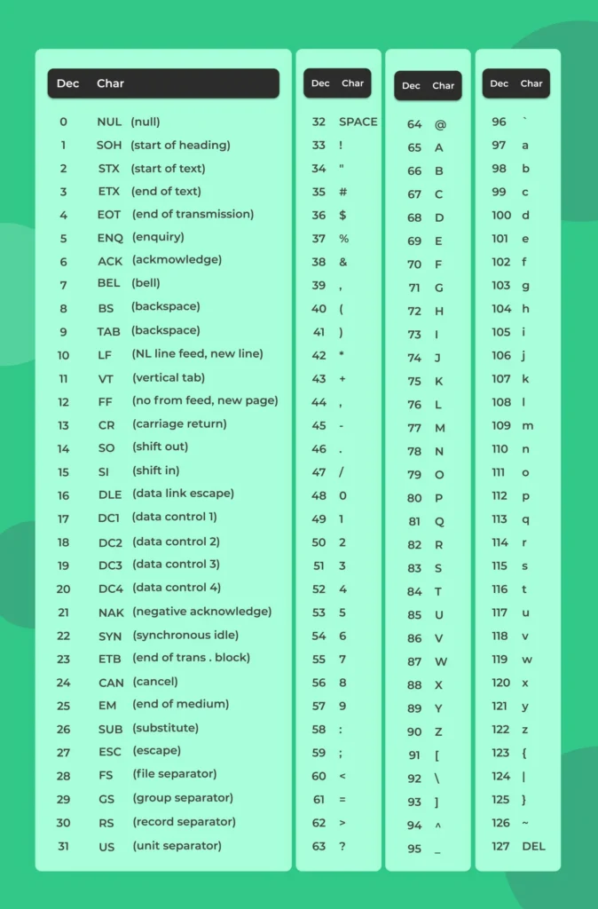
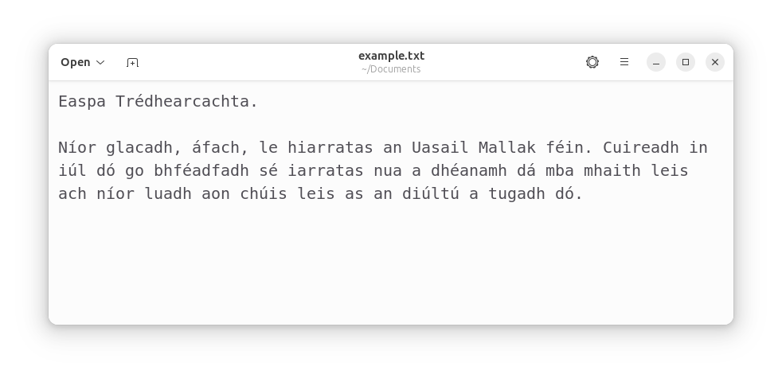
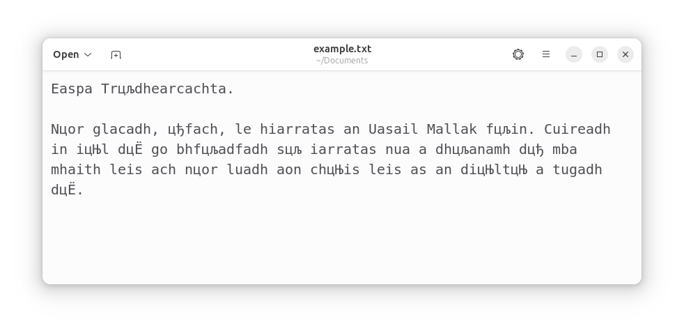
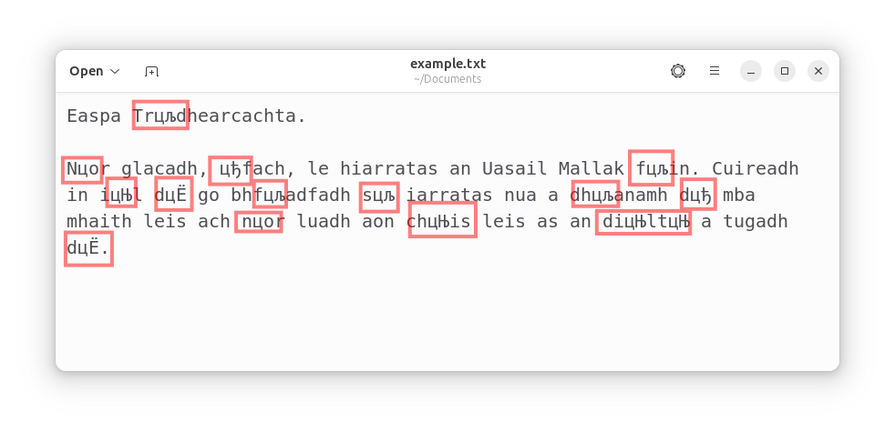
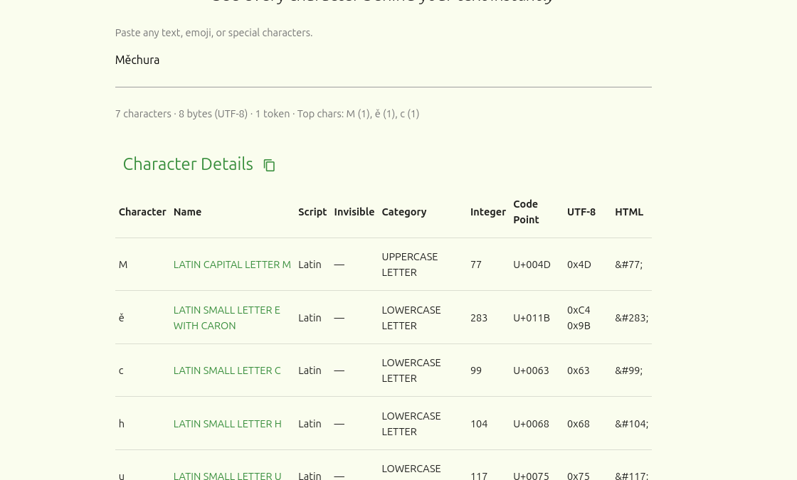
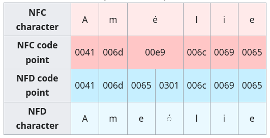
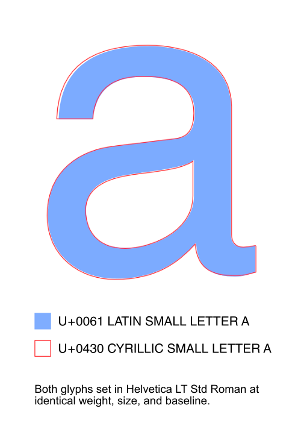
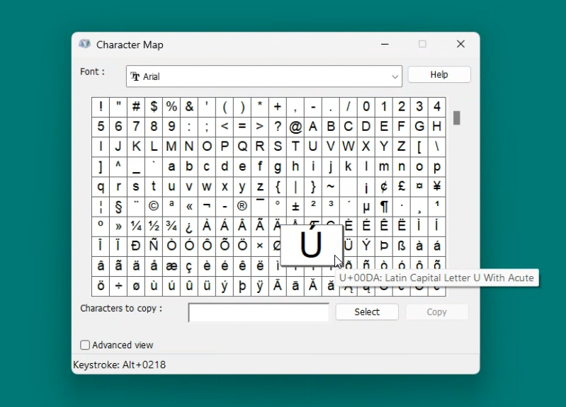
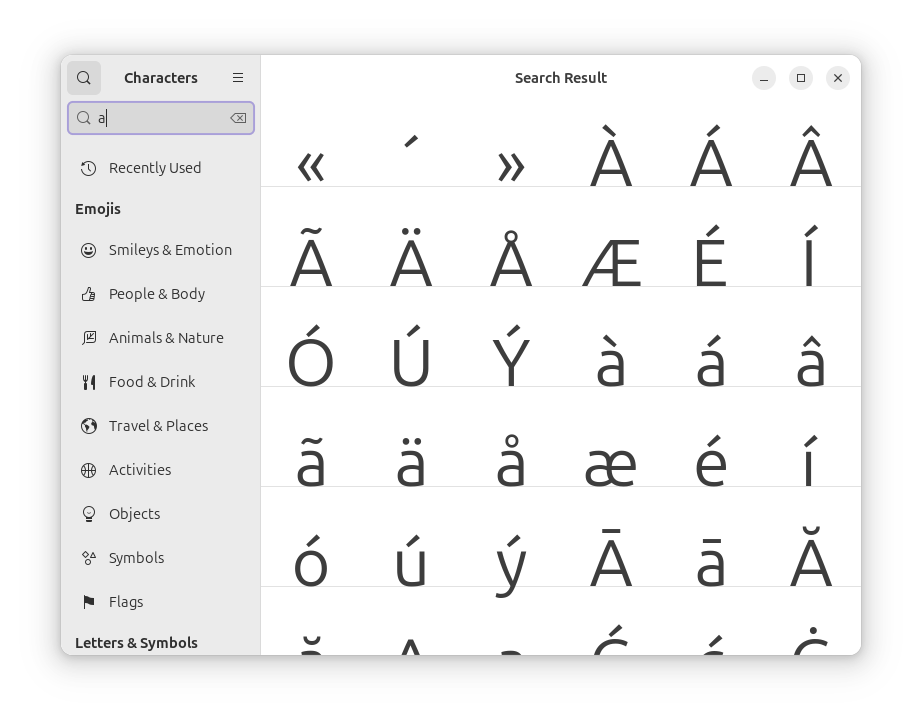
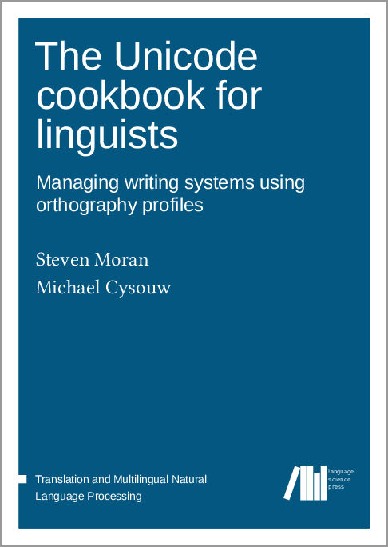

340088-1 VO Sprachtechnologien, Informations- und Interfacedesign  
Language technology lecture 1
# How computers represent characters: ASCII, Unicode and everything in between

---
## We are here
0. Introductory lecture <!--{.element class="grey"}-->

### Foundational technologies
1. **(LT1) How computers represent characters: ASCII, Unicode and everything in between**
2. (LT2) Working with text: spellcheckers, grammar correctors, AI writing assistants
3. (IM1) Formats for representing text: Markdown, XML and their uses
4. (IM2) Managing data: JSON, YAML, relational databases, Semantic Web.

### A dive into NLP and AI
5. (LT3) Intro to Natural Language Processing (NLP): tagging, parsing and their applications
6. (LT4) Understanding the technology behind NLP: language models, vectors, word embeddings
7. (LT5) Large Language Models (LLMs): understanding how they do what they do

### Multilingual software
8. (UI1) Understanding user interfaces: what designing a good user experience is about
9. (UI2) Software localisation and globalisation: the challenge of translating on-screen text
10. (IM3) Understanding Internet technology: how the Internet works under the hood
11. (UI3) Managing multilingual websites: pitfalls to avoid on the multilingual web

---
Revision
## Which of these are examples of *natural languages*?
- German, Arabic, Swahili
- Python, C++, JavaScript
- XML, JSON, SQL

---
Revision
## Which of these are the *modalities* of language?
- Spoken, written, signed
- Speech-to-text, text-to-speech, speech-to-speech, text-to-text
- Translation, interpreting, localisation

---
Revision
## What does NLP stand for? \*
- Natural Language Processing
- Neuro-Linguistic Programming

&nbsp;

\* In the context of this course. <!--{.element class="small"}-->

---
340088-1 VO Sprachtechnologien, Informations- und Interfacedesign  
Language technology lecture 1
# How computers represent characters: ASCII, Unicode and everything in between

---
## Plan for today
- How computers represent the characters of various languages, alphabets and writing systems.
- The diversity of European character sets.
- The evolution of character encoding from ASCII to Unicode.
- Concepts such as ‘codepage’ and ‘extended character’.
- Understanding (some of) the complexity of Unicode: combining characters, Unicode normalisation, UTF-8.
- Dealing with wrongly encoded text.
- Changing the character encoding of text in various software packages.
- Inputting text in various languages using different keyboard layouts, alternative input methods and character pickers.

---
## Character encoding

- You see:  
  **Happy.**

- The computer sees:  
  **[72, 97, 112, 112, 121, 46]**

---
## ASCII
- “American Standard Code for Information Interchange”
- 1963, American National Standards Institute (ANSI)
- Numbers 0 – 127, each number represents one character
  - Control characters: 0 – 31, 127
  - Printable characters: 32 – 126  
    http://arit.lexiconista.com/arit/character-encoding-tables/?e=ascii

---
## ASCII printable characters
- Space (32)
- Symbols and punctuation (33 – 47, 58 – 64, 91 – 96, 123 – 126)
- Numerals “0” – “9” (48 – 57)
- Upper-case letters “A” – “Z” (65 – 90)
- Lower-case letters “a” – “z” (97 – 122)

---
## ASCII control characters
- “start of heading” (1)
- “bell” (7)
- “backspace” (8)
- “tab” (9)
- “line feed” (10)
- “carriage return (13)
- “form feed” (12)
- "escape" (27)
- "delete" (127)

---
## ASCII: why exactly 128 characters?

  0000000 = 0  
  0000001 = 1  
  0000010 = 2  
  0000011 = 3  
  0000100 = 4  
  0000101 = 5  
  0000110 = 6  
  0000111 = 7  
  0001000 = 8  

  &nbsp;  
  &nbsp;  
  &nbsp;  
  &nbsp;  
  · · ·

  1000001 = 65  
  1000010 = 66  
  1000011 = 67  
  1000100 = 68  
  1000101 = 69  
  1000110 = 70  
  1000111 = 71  
  1001000 = 72  
  1001001 = 73  

  &nbsp;  
  &nbsp;  
  &nbsp;  
  &nbsp;  
  · · ·

  1110111 = 119  
  1111000 = 120  
  1111001 = 121  
  1111010 = 122  
  1111011 = 123  
  1111100 = 124  
  1111101 = 125  
  1111110 = 126  
  1111111 = 127  

---
## Does this prehistory matter today?
- Text “in ASCII” usually means text in Latin characters without accents.
  - Still somewhat relevant in Internet URLs.
- EBCDIC (an equally old “competitor” to ASCII, created by IBM):
  - Still used in some banking software.

---
## What’s missing from ASCII
- Symbols:
  - Various shapes of quotation marks
  - Em-dashes, en-dashes...
  - Currency symbols...
- **Extended characters** (= Latin characters with **accents**)
  - German: ä ö ü
  - Czech: á é ě í ó ú ů č ď ň ř š ť ž
  - Irish: á é í ó ú
- Characters that *extend* the Latin alphabet
  - German: ß
  - Islandic: þ
- Characters from non-Latin writing systems
  - Cyrillic: а б в г д...
  - Greek: α β γ δ ε...
  - Arabic, Hebrew, Chinese, Korean...

---
Side note
## Which writing systems do you know?
- Latin, Cyrillic, Greek
- Arabic, Hebrew
- Chinese (Traditional, Simplified), Kanji
- Kana: Hiragana, Katakana
- Korean
- ... 

---
True or false? 
## “Each language uses exactly one writing system.”
  
---
## How they used to write in ASCII
- Leaving it out
  - Czech: “řidič” → “ridic”
- Faking it
  - German: “österreichisch” → “oesterreichisch”
  - Irish: “sásta” → “sa/sta”
- **Romanisation**
  - Russian: “правда” → “pravda”

Still somewhat relevant for Internet URLs.

---
## 1980s: the age of character sets

ISO 8859 “8-bit single-byte coded graphic character sets”
- ISO 8859-1 (“Latin-1”): Latin characters for Western European languages
- ISO 8859-2 (“Latin-2”): Latin characters for Central European languages
- ISO 8859-5 (“Latin-Cyrillic”): Cyrillic characters
- ISO 8859-6 (“Latin-Arabic”): Arabic characters
- etc.

---
## How ISO 8859 works
Each character set is:
- 0 – 127: same as ASCII
- 128 – 255: additional characters

---
## ISO 8859: why exactly 256 characters?

  00000000 = 0  
  00000001 = 1  
  00000010 = 2  
  00000011 = 3  
  00000100 = 4  
  00000101 = 5  
  00000110 = 6  
  00000111 = 7  
  00001000 = 8  

  &nbsp;  
  &nbsp;  
  &nbsp;  
  &nbsp;  
  · · ·

  01110111 = 119  
  01111000 = 120  
  01111001 = 121  
  01111010 = 122  
  01111011 = 123  
  01111100 = 124  
  01111101 = 125  
  01111110 = 126  
  01111111 = 127  

  &nbsp;  
  &nbsp;  
  &nbsp;  
  &nbsp;  
  · · ·

  11110111 = 247  
  11111000 = 248  
  11111001 = 249  
  11111010 = 250  
  11111011 = 251  
  11111100 = 252  
  11111101 = 253  
  11111110 = 254  
  11111111 = 255  

---
Side note
## Computer terminology
- **bit** = a one or a zero
- **byte** = eight bits
- **kilobyte** =
  - 1,000 bytes (metric system)
  - 1,024 bytes (210, traditional IT usage)
- **megabyte**
- **gigabyte**
- ...

---
## ISO 8859 examples
- ISO 8859-1 (“Latin-1”): Latin characters for Western European languages  
  http://arit.lexiconista.com/arit/character-encoding-tables/?e=iso-8859-1
- ISO 8859-2 (“Latin-2”): Latin characters for Central European languages  
  http://arit.lexiconista.com/arit/character-encoding-tables/?e=iso-8859-2
- ISO 8859-5 (“Latin-Cyrillic”): Cyrillic characters  
  http://arit.lexiconista.com/arit/character-encoding-tables/?e=iso-8859-5
- ISO 8859-6 (“Latin-Arabic”): Arabic characters
  http://arit.lexiconista.com/arit/character-encoding-tables/?e=iso-8859-6

---
## Non-ISO chararacter sets 
- Microsoft “codepages”
  - Windows-1252: Western-European languages
  - Windows-1250: Central-European languages
  - Windows-1251: Cyrillic
- National governments, private initiatives
  - KOI8-R: Russian
  - Big5 : Chinese

---
## Corrupted text
“**Š**” → ISO 8859-2 → **169** → ISO 8859-5 → “**Љ**”

---

---

---

---
## Unicode
- All the characters of all the languages the wold, alive or dead 
- Uncode Consortium www.unicode.org, from 1991 onwards
- Currently: version 18 containing 310,341 characters
- Each character has a number, a so-called **codepoint**.
  - Characters 1 – 127 are the same as ASCII

---
## What Unicode knows about each character

---
## Unicode codepoints
Usually given as: 
  - “U+”
  - followed by a hexadecimal number
    - front-padded by zeros to be four digits

Example:
- **U+004C**
- This is the hexadecimal number **4C**
- Which is the decimal number **76**.
- Which corresponds to the letter **L**:  
  http://arit.lexiconista.com/arit/character-encoding-tables/?e=unicode

---
Side note
## Hexadecimal notation
- Binary notation eg. **1001100**
  - Each is position is a 0 or a 1
- Decimal notation eg. **76**
  - Each position is one of: 0, 1, 2 ... 7, 8, 9
- Hexadecimal notation: **4C**
  - Each position is one of: 0, 1, 2 ... 7, 8, 9, A ... F

---
## Combining characters versus and precomposed characters

---
## Unicode normal forms

---
## Homoglyphs

---
## Unicode encoding
- Unicode: Gives each a character a number.
- A Unicode encoding: transforms that number into bits and bytes.
  - **UTF-8**: each codepoint is encoded as *one byte* (eight bits) if possible, more if needed.
  - **UTF-16**: each codepoint is encoded as *two bytes* (sixteen bits) if possible, more if needed.

---
## Finding and inputting characters (Windows)

---
## Finding and inputting characters (Ubuntu Linux)

---
## Recommended reading (1/3)

Chapter 1 of ‘Language and computers’  
https://langsci-press.org/catalog/book/454

---
## Recommended reading (2/3)

- Chapters 1, 2, 3 of ‘The Unicode cookbook for linguists’  
https://langsci-press.org/catalog/book/176

---
## Recommended reading (3/3)

Chapters 1, 2, 3.1 of ‘An Ríomhaire Ilteangach’ [The Multilingual Computer]  
http://arit.lexiconista.com/arit/

