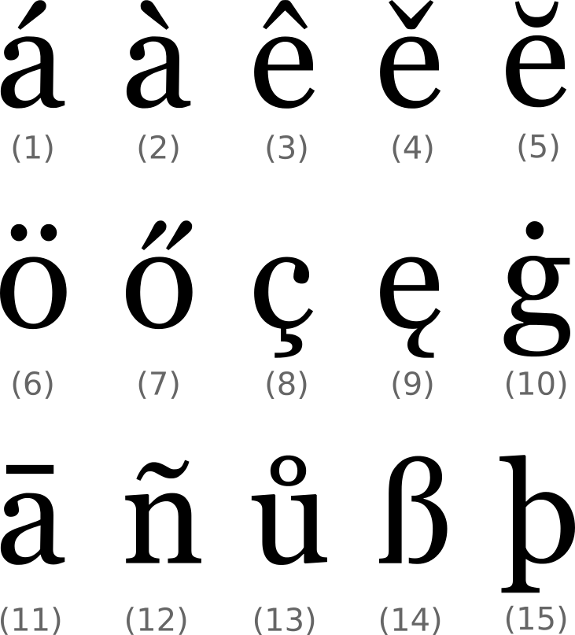
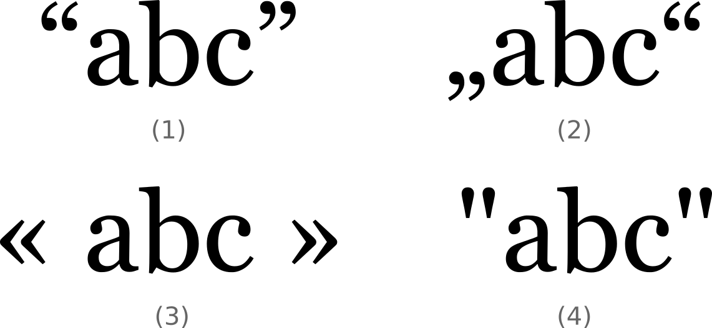
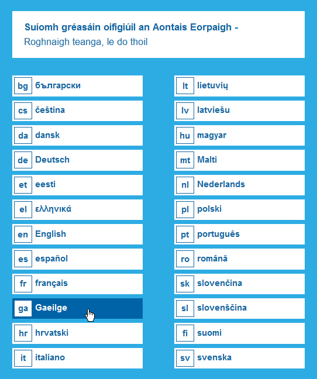
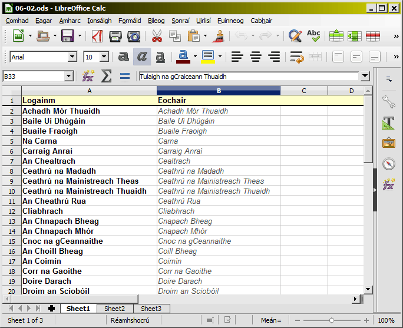
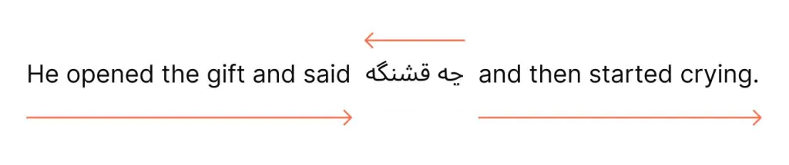

340088-1 VO Sprachtechnologien, Informations- und Interfacedesign  
Language technology lecture 2
# Working with text: going above the level of character encoding

---
## We are here
0. Introductory lecture <!--{.element class="grey"}-->

Foundational technologies

1. (LT1) How computers represent characters: ASCII, Unicode and everything in between <!--{.element class="grey"}-->
2. **(LT2) Working with text: going above the level of character encoding**
3. (IM1) Formats for representing text: Markdown, XML and their uses
4. (IM2) Managing data: JSON, YAML, relational databases, Semantic Web.

A dive into NLP and AI

5. (LT3) Intro to Natural Language Processing (NLP): tagging, parsing and their applications
6. (LT4) Understanding the technology behind NLP: language models, vectors, word embeddings
7. (LT5) Large Language Models (LLMs): understanding how they do what they do

Multilingual software

8. (UI1) Understanding user interfaces: what designing a good user experience is about
9. (UI2) Software localisation and globalisation: the challenge of translating on-screen text
10. (IM3) Understanding Internet technology: how the Internet works under the hood
11. (UI3) Managing multilingual websites: pitfalls to avoid on the multilingual web

---
Revision
## What is character encoding?
1. Something which assigns a unique numerical identifier to every character.
2. An algorithm for reducing a long string of text into a single number.
3. A method for translating text from one language to another.

---
Revision
## Does ASCII contain the character “ü”?
1. Yes.
2. No.

---
Revision
## Of all the characters of all the writing systems of the world, which characters does Unicode contain?
1. Those not included in ASCII.
2. Those not included in ISO 8859-1.
3. All of them.

---
Revision
## What is an *extended character*?
1. A Latin character like **ü** and **ž**.
2. A character from a non-Latin alphabet like Cyrillic and Greek.
3. A character from a non-alphabetic writing systems like Chinese.

---
Revision
## What is a *codepage*?
1. Another word for a *character set*.
2. The first 128 characters of any character set.

---
Revision
## What is a *codepoint*?
1. A Unicode term for a number assigned to a character.
2. The part of any decimal number after the decimal dot.
3. Another word for a *bit*.

---
Revision
## How many bits are there in a byte?
1. Eight.
2. Ten.
2. Sixteen.

---
Revision
## In computer terminology, what is a *bit*?
1. Something very very small.
2. A one or a zero.
3. Any sequence of any number of ones and zeros.

---
Revision
## When you see `U+004C`, what are you probably looking at?
2. The identifier of a Unicode codepoint.
1. The address of character in ASCII.
3. The unique address of a computer connected to the Internet.

---
Revision
## How many ways are there in Unicode for representing “ü”?
1. One.
2. Two.
3. Infinitely many.

---
Revision
## In character encoding terminology, what is a *glyph*?
1. Another word for *character*. 
2. Another word for a Unicode *codepoint*. 
3. The shape of a character.

---
Revision
## What is UTF-8?
1. A more formal name for Unicode.
2. A Unicode *encoding*: a method for transforming the number of a codepoint into a sequence of ones and zeros.

---
340088-1 VO Sprachtechnologien, Informations- und Interfacedesign  
Language technology lecture 2
# Working with text: going above the level of character encoding

---
## Plan for today
Language-related issues when handling text on computers
  - Punctuation
  - Quotation marks
  - Number and date formatting
  - Capitalisation
  - Names of people and things
  - Alphabetical sorting
  - End-of-line word hyphenation
  - Right-to-left text

---
## The Latin alphabet from language to language

 <!--{.element style="height: 500px"}-->

---
## Same glyph, different codepoints

  ### a

  U+0061 LATIN SMALL LETTER A

  ### а

  U+0430 CYRILLIC SMALL LETTER A

---
## Similar glyph, different codepoints (1/2)

  ### B

  U+0042 LATIN CAPITAL LETTER B

  ### в

  U+0432 CYRILLIC SMALL LETTER VE

---
## Similar glyph, different codepoints (2/2)

  ### ß

  U+00DF LATIN SMALL LETTER SHARP S

  ### β

  U+03B2 GREEK SMALL LETTER BETA

---
## Lower-case, upper-case
- The concept of character case only exists in Latin, Cyrillic and Greek writing systems.
- Some case-changing rules are language-specific.

---
## Example: upper-casing “i” (in most languages)

  ### i

  U+0069 LATIN SMALL LETTER I

  ### I

  U+0049 LATIN CAPITAL LETTER I

---
## Example: Upper-casing “i” (in Turkish)

  ### ı

  U+0131 LATIN SMALL LETTER DOTLESS I
  
  ### i

  U+0069 LATIN SMALL LETTER I

  ### I

  U+0049 LATIN CAPITAL LETTER I

  ### İ

  U+0130 LATIN CAPITAL LETTER I WITH DOT ABOVE

---
## Language-specificity
- To perform an operation (e.g. upper-casing) on a string of text, the software (e.g. your word processor) needs to know **which language** the text is in.

---
## Side note: What do you use to write?
1. LibreOffice, OpenOffice
2. Microsoft Word (locally on my computer)
3. Microsoft Word (in the cloud)
4. Google Docs
5. Something else

---
## Quotation marks
 <!--{.element style="height: 300px"}-->

---
## Punctuation
 <!--{.element style="height: 300px"}-->

---
## Spaces in Unicode
- U+0020 SPACE
- U+00A0 NO-BREAK SPACE
- U+200B​ ZERO WIDTH SPACE

---
## End-of-line word hyphenation
What if the next word doesn't fit on what remains of the line?
- Word wrapping
- Hyphenation

---
## Hyphens in Unicode
- U+002D HYPHEN-MINUS
- U+2011 NON-BREAKING HYPHEN
- U+00AD ­SOFT HYPHEN

---
## Numbers

  ### 1,651.34

  ### 1.651,34
  ### 1 651,34

  ### 1'651.34

---
## Amounts of money (1/2)

  ### €1,651.34  
  ### $1,651.34
  ### £1,651.34

  ### 1.651,34 €

---
## Amounts of money (2/2)
- Symbols like £ and $ are ambiguous.
  - Which country’s dollar? Which country’s pound? 
- ISO 4217 standardizes unambiguous codes for currencies.
  - USD, GBP, EUR...

---
## Ordinal numbers

  ### 6th floor

  ### 6. Stock

  ### 6-й этаж

---
## Dates
- Sequencing
  - **12 May 2023**
  - **May 12, 2023**
- Long versus short
  - **Monday, 12 May 2023**
  - **12/05/2023**
- Language-specific wording, punctuation, capitalisation
  - English: **Monday, 12(th of) May 2023**
  - German: **Montag, 12. Mai 2023**
  - Czech: **pondělí, 12. května 2023**
  - Russian: **понедельник, 12 мая 2023 г.**

---
## Times
- 24-hour clock versus 12-hour clock
  - **14:30**
  - **2:30 PM**
- Language-specific wording, punctuation, capitalisation
  - English: **2:30 PM**
  - Czech: **2:30 odp.**
- Timezones!

---
## ISO 8601: unambiguous format for dates and times
- 2023-05-12
- 14:30:00

---
## Capitalisation of names
- English:
  - **European Union**
  - **Republic of Ireland**
  - **United States of America**
- Czech:
  - **Evropská unie**
  - **Irská republika**
  - **Spojené státy americké**

---
## Capitalisation of names of languages

---
## People’s names
- Sequencing
  - Given name → surname: **Sarah Connor**
  - Surname → give name: **Nagy István**
- Capitalisation, punctuation, spacing
  - **Lothar de Maizière**
  - **Peadar Ó Súilleabháin**
  - **Peter O’Sullivan**
- Where is the surname?
  - **José Gómez Iglesias**
  - **Иван Иванович Иванов** (Ivan Ivanovich Ivanov)
  - **Miguel Angel Rios Gaona**
- Is there a surname, even?

---
## Alphabetical sorting
- Latin alphabet
  - English: **A → ... → Z**
  - Irish: **A → Á → ... → Z**
  - German: **A|Ä → ... → Z**
  - Swedish: **A → ... → Z → Å → Ä → Ö**
- Cyrillic, Greek, Arabic...
- Chinese...

---
## Sortkeys

---
## *Collation*
A set of rules for comparing and sorting strings of text
- What is the order of characters?
- Is it case-sensitive? (eg. **a = A**?)
- Is it accent-sensitive (eg. **A = Ä**?)

---
## Bidirectional text
 <!--{.element style="width: 800px"}-->

---
## Bidirectional text
- U+200F Right-to-Left Mark
- U+200E Left-to-Right Mark

---
## Plan for today
Language-related issues when handling text on computers <!--{.element class="grey"}-->
  - Punctuation <!--{.element class="grey"}-->
  - Quotation marks <!--{.element class="grey"}-->
  - Number and date formatting <!--{.element class="grey"}-->
  - Capitalisation <!--{.element class="grey"}-->
  - Names of people and things <!--{.element class="grey"}-->
  - Alphabetical sorting <!--{.element class="grey"}-->
  - End-of-line word hyphenation <!--{.element class="grey"}-->
  - Right-to-left text <!--{.element class="grey"}-->

---
## Language-specific textual features
- To perform an operation on a string of text, you and your software need to know:
  - which language the text is in,
  - which culture the text is from/for.
- Awareness of language-specific textual features is a **transcultural communication** skill.
  - Do not over-eagerly “correct” stuff.

---
## Recommended reading

Chapters 3–7 of ‘An Ríomhaire Ilteangach’ [The Multilingual Computer]  
http://arit.lexiconista.com/arit/

---
## That’s it, see you next week!

