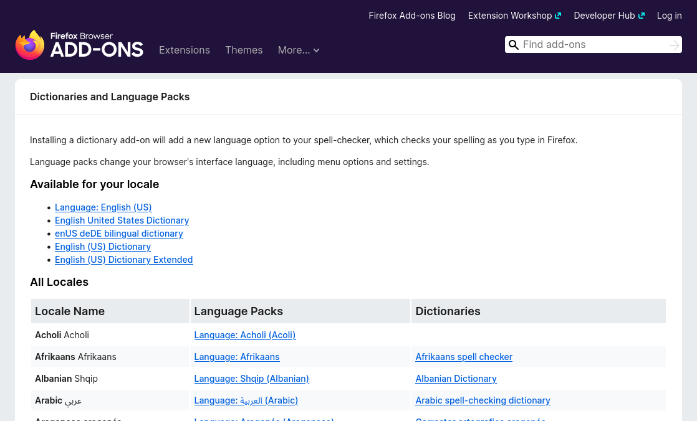
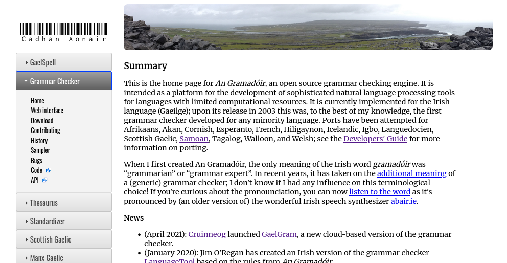
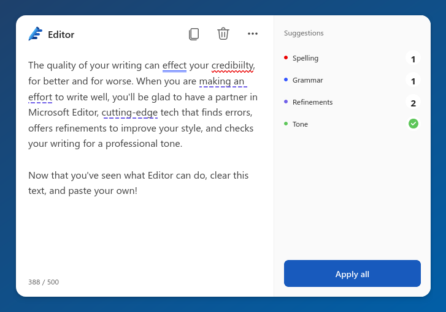
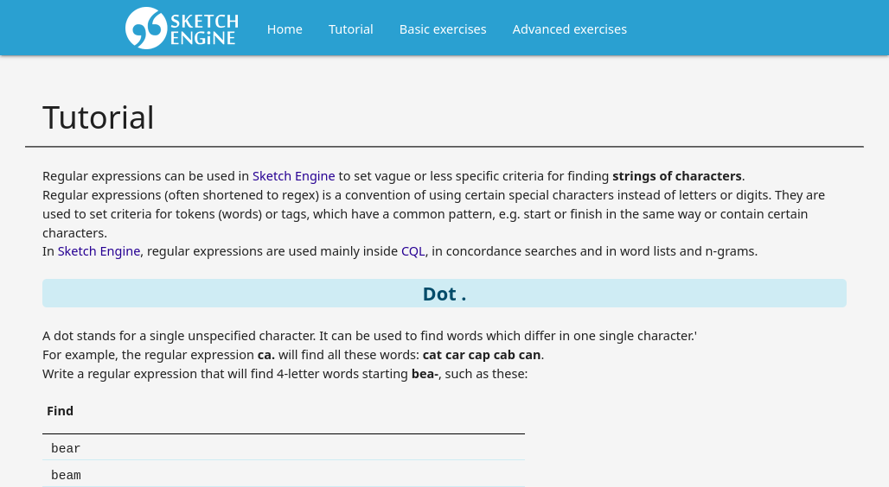

340088-1 VO Sprachtechnologien, Informations- und Interfacedesign  
Language technology lecture 2A
# From spellcheckers to AI writing assistants

---
## We are here
0. Introductory lecture <!--{.element class="grey"}-->

Foundational technologies

1. (LT1) How computers represent characters: ASCII, Unicode and everything in between <!--{.element class="grey"}-->
2. (LT2) Working with text: going above the level of character encoding <!--{.element class="grey"}-->
    <div style="color: #000000"><span class="hilite"><b>(LT2A) From spellcheckers to AI writing assistants</b></span></div>
3. (IM1) Formats for representing text: Markdown, XML and their uses
4. (IM2) Managing data: JSON, YAML, relational databases, Semantic Web.

A dive into NLP and AI

5. (LT3) Intro to Natural Language Processing (NLP): tagging, parsing and their applications
6. (LT4) Understanding the technology behind NLP: language models, vectors, word embeddings
7. (LT5) Large Language Models (LLMs): understanding how they do what they do

Multilingual software

8. (UI1) Understanding user interfaces: what designing a good user experience is about
9. (UI2) Software localisation and globalisation: the challenge of translating on-screen text
10. (IM3) Understanding Internet technology: how the Internet works under the hood
11. (UI3) Managing multilingual websites: pitfalls to avoid on the multilingual web

---
Revision
## Falsehoods programmers believe about languages
https://www.lexiconista.com/falsehoods-about-languages/
---
Falsehoods programmers believe about languages
## The lower-case/upper-case distinction exists in all languages.
---
Falsehoods programmers believe about languages
## For every lower-case character, there is exactly one (language-independent) upper-case character, and vice versa.
---
Turkish:
- **i** → **İ**
- **ı** → **I**
---
Falsehoods programmers believe about languages
## When a placename, the name of an institutions or any other name contains more than one word, it is written in Title Case such that each word begins with an upper-case character.
---
- Czech: Evropská unie
- French: Union européenne
- English: Office of the Ombudsman
---
Falsehoods programmers believe about languages
## When words are to be converted into Title Case, it is always the first character of the word that needs to be capitalized, in all languages.
---
Dutch:
- IJsselmeer
- IJmuiden

Irish:
- Bóthar na bhFál
- An tAontas Eorpach
---
Falsehoods programmers believe about languages
## Each language is written in exactly one alphabet.
---
Falsehoods programmers believe about languages
## All languages (that use the Latin alphabet) have the same alphabetical sorting order.
---
- In Swedish, Ä comes at the end of the alphabet, after Z.

- In German, Ä is sorted as if it were AE: München comes between Mud and Muf as if it were written Muenchen
---
Falsehoods programmers believe about languages
## All languages are written from left to right.
---
Falsehoods programmers believe about languages
## Every language puts spaces between words.
---
Falsehoods programmers believe about languages
## No language puts spaces before question marks and exclamation marks at the end of a sentence.
---
Falsehoods programmers believe about languages
## Questions marks and exclamation marks always appear at the end of the sentence.
---
Spanish:
- ¿Dónde está tu chaqueta?
- ¡Qué buena idea!
- Tengo galletas, ¿quieres una?
---
Falsehoods programmers believe about languages
## No language puts spaces after opening quotes and before closing quotes.
---
Falsehoods programmers believe about languages
## All languages use the same characters for opening quotes and closing quotes.
---
Falsehoods programmers believe about languages
## Numbers, when written out in digits, are formatted and punctuated the same way in all languages.

---
340088-1 VO Sprachtechnologien, Informations- und Interfacedesign  
Language technology lecture 2A
# From spellcheckers to AI writing assistants

---
## Plan for today
- Spellchecking
- Grammar correction
- AI writing assistants

---
## Spellchecking
 <!--{.element style="width: 100%"}-->

---
## Spellchecking
 <!--{.element style="width: 100%"}-->

---
## Spellchecking
 <!--{.element style="width: 100%"}-->

---
## Spellchecking
 <!--{.element style="width: 100%"}-->

---
## Spellchecking
 <!--{.element style="width: 100%"}-->

---
## Spellchecking
- Checks each word against a “dictionary” of valid words.
- Typically ignores syntax, semantics.
- Typically available as a feature in your desktop software (word processor, web browser)
  - The spellchecking happens locally on your own computer.

---
## Hunspell
https://hunspell.github.io/
- Open-source spellchecking engine
  - Spellcheckers in Firefox, LibreOffice etc, are actually Hunspell.
- A Hunspell spellchecker (for a given language) consists of:
  - `.dic` file = a dictionary of *root words*
  - `.aff` file = a list of affixes to derive valid *word forms* from root words

---
## `de.dic`

```
·
·
·
mücke/Nozm
mücken/hke
mückenfrei/A
mückenplage/Nozm
müde/A
müdigkeit/ozm
müdigkeitsgefühl/EPSozm
müglitztal/Sozm
mühelos/A
·
·
·
```

---
## `de.aff`

```
·
·
·
SFX A   0       r          e
SFX A   0       n          e
SFX A   0       m          e
SFX A   0       s          e

·
·
·
```


---
## `de.dic`

```
·
·
·
hübe/Nozm
hüben
hüben/n
hübsch/A
hübschere/A
hübscheste/A
hüft/hke
hüfte/Nozm
·
·
·
```

---
## `de.aff`

```
·
·
·
SFX A   0       e          [^e]
SFX A   0       er         [^e]
SFX A   0       en         [^e]
SFX A   0       em         [^e]
SFX A   0       es         [^e]

·
·
·
```

---
## What looking inside a spellchecker teaches us (1/2)
The difference between
- the base form of a word
    - called the *root*, the *stem* or the *lemma*
- and all other forms of the word
    - called *word forms* or *tokens*

Example:
- "hübsch" → "hübsche", "hübscher", "hübschen", "hübschem", "hübsches"

---
## What looking inside a spellchecker teaches us (2/2)
Regular expressions ("Regex")
- For finding strings of text that match a pattern
- Often available in the search features of a word processors etc.  

Examples:
- *Ends in* "e" → "müde" 
- *Ends in* "[^e]" → "hübsch"

A good tutorial:
- https://regex.sketchengine.eu/tutorial.html

---
## Grammar correction

*"Ich habe nach Hause gegangen, weil es regnet zu stark."*
- Spellchecker says OK.
- Grammar corrector (hopefully) says not OK.

---
## Grammar correction
- Traditional rule-based approach:
  - Checks sequences of words against known patterns
  - Recently often augmented with “AI”
- Example: [languagetool.org](https://languagetool.org)

---
## languagetool.org
 <!--{.element style="width: 100%"}-->

---
## languagetool.org
 <!--{.element style="width: 100%"}-->

---
## Example of a languagetool.org rule

```xml
<rule>
    <pattern>
        <token postag=".*ADJ.*KOM.*" postag_regexp="yes"/>
        <marker>
            <token>wie</token>
        </marker>
        <token>sonst</token>
    </pattern>
    <message>'\1 wie' ist umgangssprachlich. Verwenden Sie zum Ausdrücken von Ungleichheit <suggestion>als</suggestion>.</message>
    <example correction="als">Er ist besser <marker>wie</marker> sonst.</example>
</rule>
```

---
## An Gramadóir
 <!--{.element style="width: 100%"}-->

---
## Grammar correction
- Often available as a feature in your desktop software (word processor)
- Or as a separate product
  - Web-based app
  - Plug-in for your desktop software (word processor, web browser)
  - Rarely: dedicated desktop app

---
## AI writing assistants
 <!--{.element style="width: 100%"}-->

---
## AI writing assistants
 <!--{.element style="width: 100%"}-->

---
## AI writing assistants
 <!--{.element style="width: 100%"}-->

---
## AI writing assistants
 <!--{.element style="width: 100%"}-->

---
## Trends in writing assistance tools
- Two UI patterns
  - Underline problematic stretches.
  - Rewrite entire text + highlight differences. 
- Merging of use-cases and technologies
  - Users don’t care about the difference between spelling, grammar and style.
  - Mixture of LLMs and traditional approaches (eg. rule-based grammar checking).
- Multiple delivery channels
  - Web-based apps.
  - Plug-ins for desktop word processors.
  - Plug-ins for web browsers.
  - Plug-ins for cloud-based word processors.

---
## Recommended reading

Chapter 7 of ‘An Ríomhaire Ilteangach’ [The Multilingual Computer]  
http://arit.lexiconista.com/arit/


---
## Recommended reading

Chapter 2 ‘Writers’ aids’ of ‘Language and computers’  
https://langsci-press.org/catalog/book/454


---
## Recommended reading

Chapter 3 ‘Schreibfehler automatisch korrigieren’ of ‘Künstliche Intelligenz verstehen: Eine spielerische Einführung’  
https://www.rheinwerk-verlag.de/kuenstliche-intelligenz-verstehen-eine-spielerische-einfuehrung/


---
## Regex tutorial

 <!--{.element style="width: 100%"}-->

https://regex.sketchengine.eu/tutorial.html

---
## That’s it, see you next week!
