## Plan for today
Writing tools
  - Spellchecking
  - Grammar correction
  - AI writing assistants

---
## Spellchecking
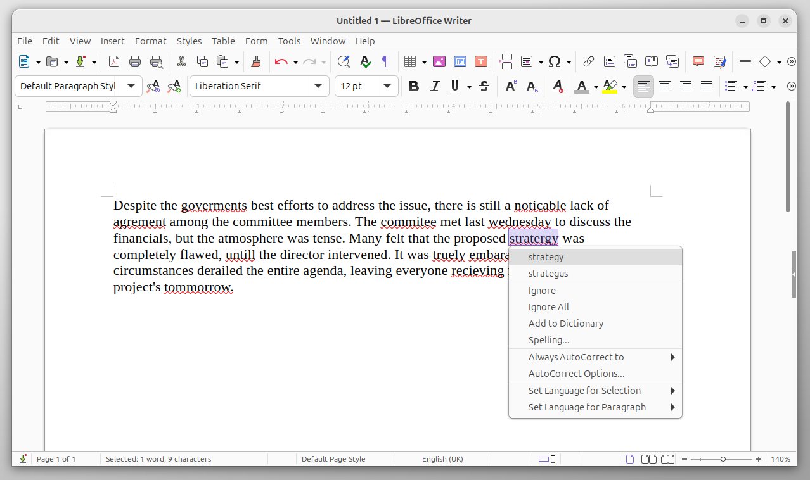 <!--{.element style="width: 100%"}-->

---
## Spellchecking
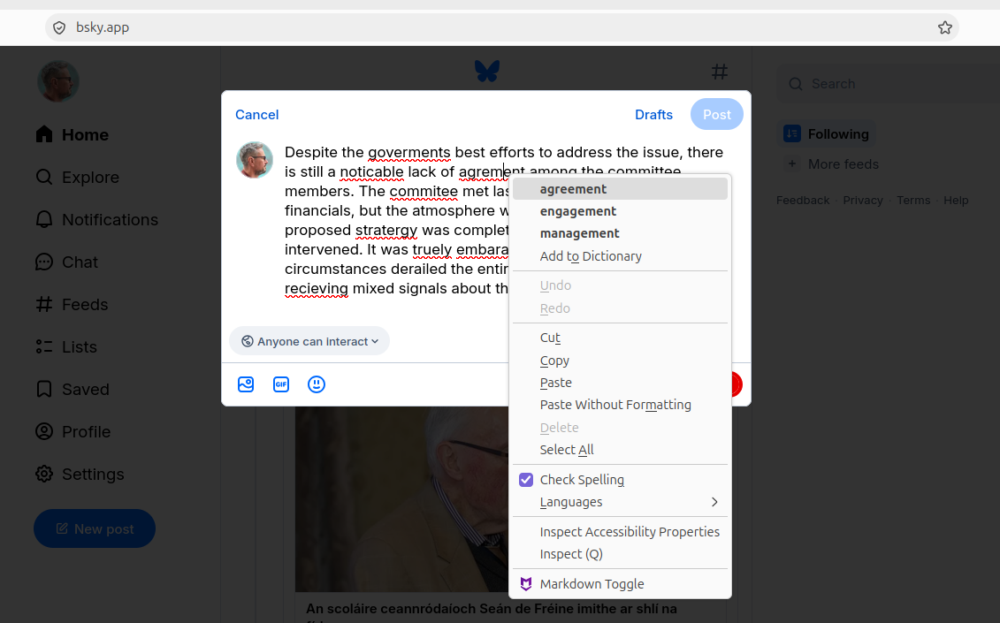 <!--{.element style="width: 100%"}-->

---
## Spellchecking
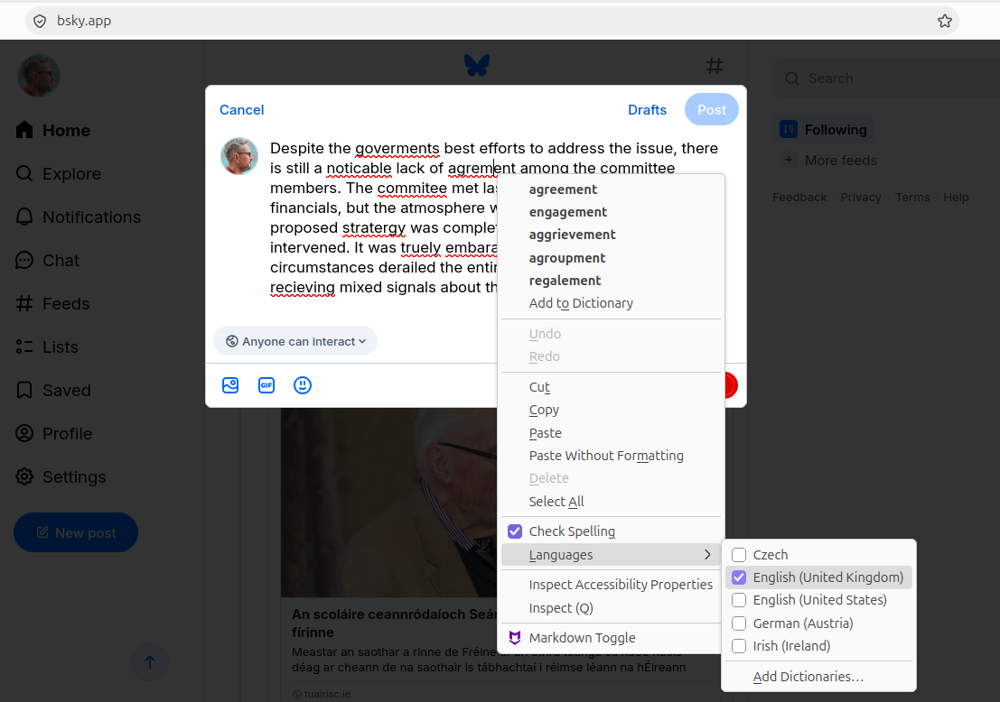 <!--{.element style="width: 100%"}-->

---
## Spellchecking
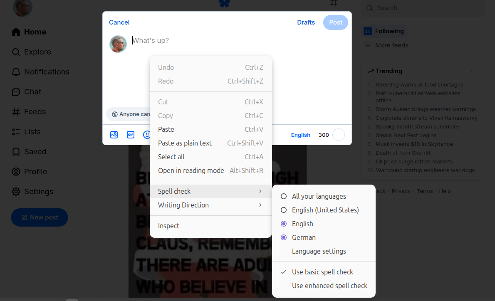 <!--{.element style="width: 100%"}-->

---
## Spellchecking
- Checks each word against a “dictionary” of valid words.
- Typically ignores syntax, semantics.
- Typically available as a feature in your desktop software (word processor, web browser)
  - The spellchecking happens locally on your own computer.

---
## Grammar correction
- Traditional rule-based approach:
  - Checks sequences of words against known patterns
  - Recently often augmented with “AI”
- Example: [languagetool.org](https://languagetool.org)

---
## languagetool.org
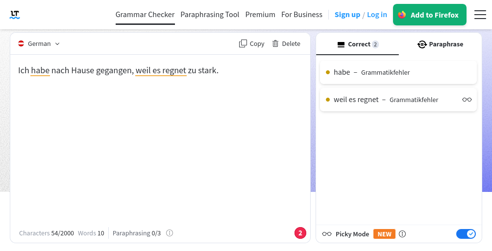 <!--{.element style="width: 100%"}-->

---
## languagetool.org
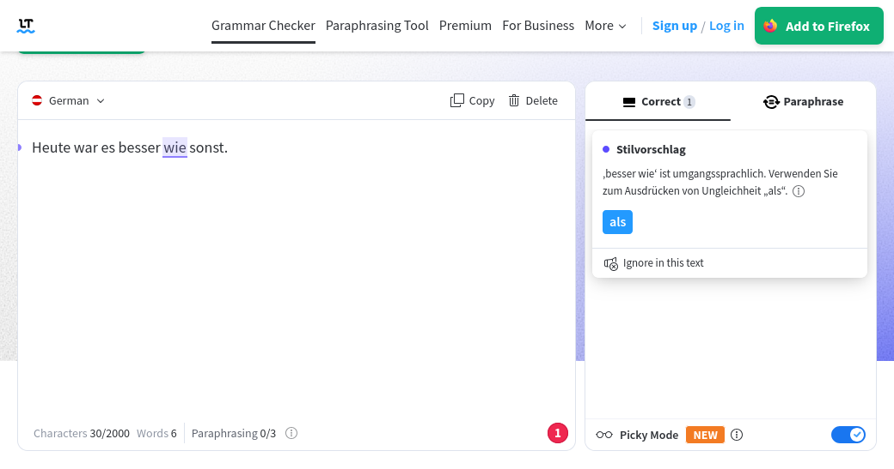 <!--{.element style="width: 100%"}-->

---
## Example of a languagetool.org rule

```xml
<rule>
    <pattern>
        <token postag=".*ADJ.*KOM.*" postag_regexp="yes"/>
        <marker>
            <token>wie</token>
        </marker>
        <token>sonst</token>
    </pattern>
    <message>'\1 wie' ist umgangssprachlich. Verwenden Sie zum Ausdrücken von Ungleichheit <suggestion>als</suggestion>.</message>
    <example correction="als">Er ist besser <marker>wie</marker> sonst.</example>
</rule>
```

---
## Grammar correction
- Often available as a feature in your desktop software (word processor)
- Or as a separate product
  - Web-based app
  - Plug-in for your desktop software (word processor, web browser)
  - Rarely: dedicated desktop app

---
## AI writing assistants
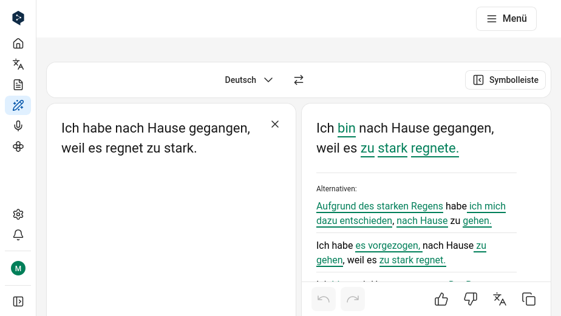 <!--{.element style="width: 100%"}-->

---
## AI writing assistants
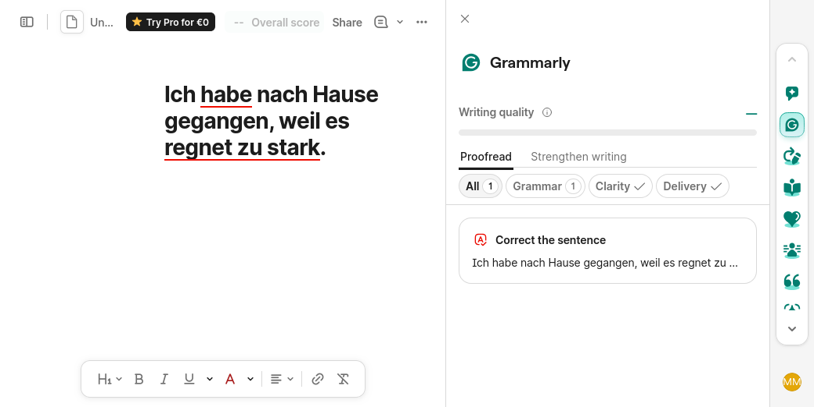 <!--{.element style="width: 100%"}-->

---
## AI writing assistants
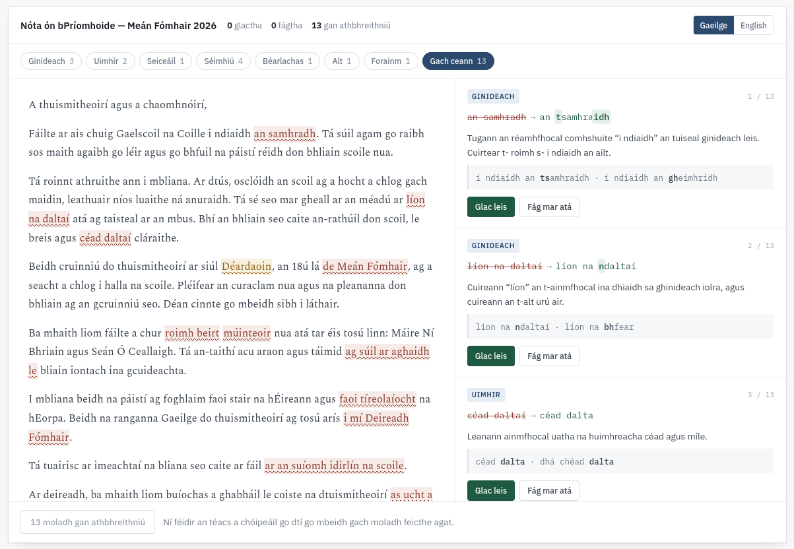 <!--{.element style="width: 100%"}-->

---
## Trends in writing assistance tools
- Two UI patterns
  - Underline problematic stretches.
  - Rewrite entire text + highlight differences. 
- Merging of use-cases and technologies
  - Users don’t care about the difference between spelling, grammar and style.
  - Mixture of LLMs and traditional approaches (eg. rule-based grammar checking).
- Multiple delivery channels
  - Web-based apps.
  - Plug-ins for desktop word processors.
  - Plug-ins for web browsers.
  - Plug-ins for cloud-based word processors.

---
## Recommended reading

Chapter 7 of ‘An Ríomhaire Ilteangach’ [The Multilingual Computer]  
http://arit.lexiconista.com/arit/

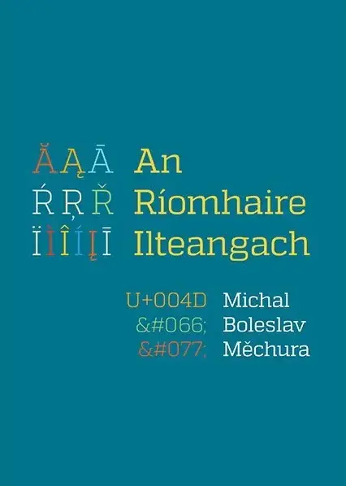

---
## Recommended reading

Chapter 2 ‘Writers’ aids’ of ‘Language and computers’  
https://langsci-press.org/catalog/book/454

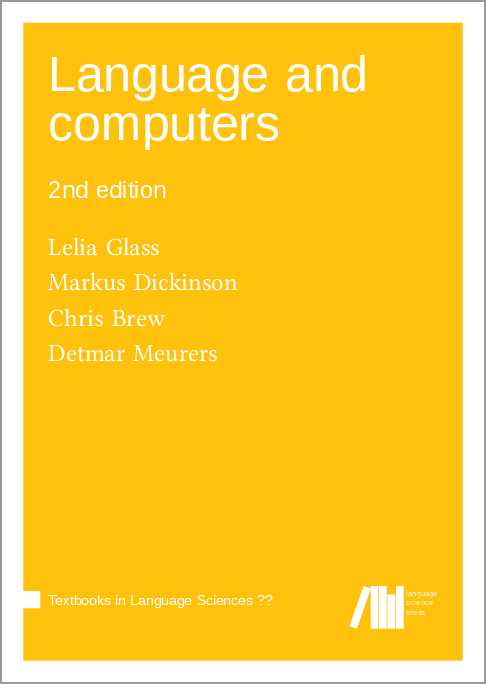

---
## Recommended reading

Chapter 3 ‘Schreibfehler automatisch korrigieren’ of ‘Künstliche Intelligenz verstehen: Eine spielerische Einführung’  
https://www.rheinwerk-verlag.de/kuenstliche-intelligenz-verstehen-eine-spielerische-einfuehrung/

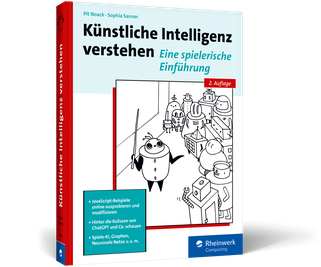

