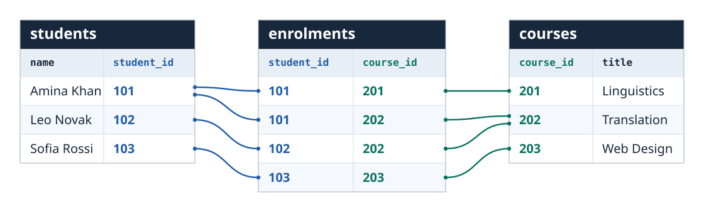
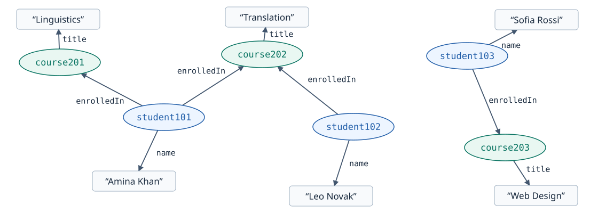
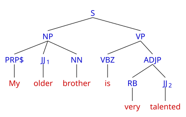
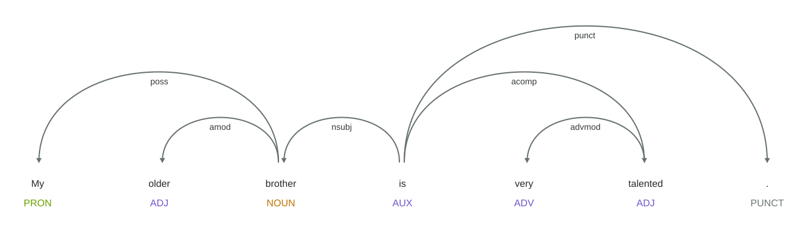
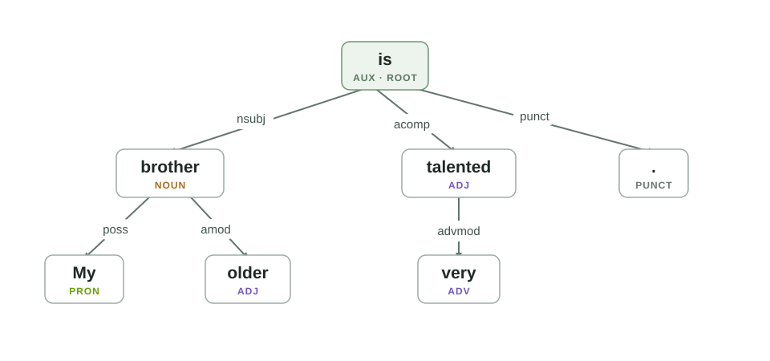
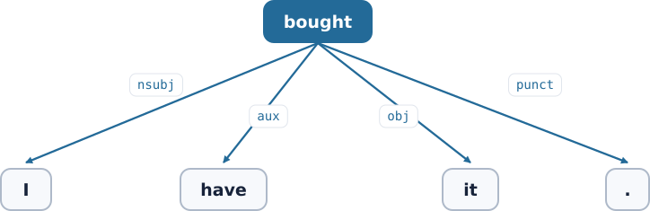
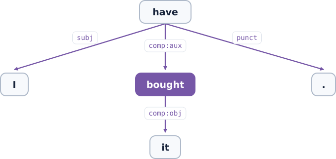
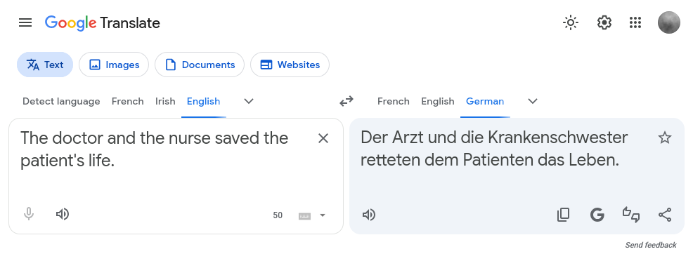

340088-1 VO Sprachtechnologien, Informations- und Interfacedesign  
Language technology lecture 3
# Introduction to Natural Language Processing (NLP): tagging, parsing and more

---
## We are here
0. Introductory lecture <!--{.element class="grey"}-->

Foundational technologies

1. (LT1) How computers represent characters: ASCII, Unicode and everything in between <!--{.element class="grey"}-->
2. (LT2) Working with text: going above the level of character encoding <!--{.element class="grey"}-->
    <div>(LT2A) From spellcheckers to AI writing assistants</div>
3. (IM1) Formats for structuring text: from plain text to XML <!--{.element class="grey"}-->
4. (IM2) Managing data: XML, JSON, YAML, databases and knowledge graphs <!--{.element class="grey"}-->

A dive into NLP and AI

5. <span class="hilite">**(LT3) Introduction to Natural Language Processing (NLP): tagging, parsing and more**</span>
6. (LT4) Understanding the technology behind NLP: language models, vectors, word embeddings
7. (LT5) Large Language Models (LLMs): understanding how they do what they do

Multilingual software

8. (UI1) Understanding user interfaces: what designing a good user experience is about
9. (UI2) Software localisation and globalisation: the challenge of translating on-screen text
10. (IM3) Understanding Internet technology: how the Internet works under the hood
11. (UI3) Managing multilingual websites: pitfalls to avoid on the multilingual web

---
Revision
## What is the name of this language?
<!-- .slide: style="height: 100%; overflow-y: auto;" -->
```
<people>
  <person>
    <names>
      <name>Leonardo da Vinci</name>
      <name>Leonardo di ser Piero da Vinci</name>
    </names>
    <birth>
      <date>1452-04-15</date>
      <place>
        <name>Vinci</name>
        <countryCode>ITA</countryCode>
      </place>
    </birth>
    <death>
      <date>1519-05-02</date>
      <place>
        <name>Amboise</name>
        <countryCode>FRA</countryCode>
      </place>
    </death>
    <otherResidences>
      <place>
        <name>Florence</name>
        <countryCode>ITA</countryCode>
      </place>
      <place>
        <name>Milan</name>
        <countryCode>ITA</countryCode>
      </place>
      <place>
        <name>Rome</name>
        <countryCode>ITA</countryCode>
      </place>
    </otherResidences>
    <professions>
      <profession>painter</profession>
      <profession>polymath</profession>
      <profession>inventor</profession>
      <profession>sculptor</profession>
    </professions>
  </person>
  <person>
    <names>
      <name>Marie Curie</name>
      <name>Maria Salomea Skłodowska</name>
    </names>
    <birth>
      <date>1867-11-07</date>
      <place>
        <name>Warsaw</name>
        <countryCode>POL</countryCode>
      </place>
    </birth>
    <death>
      <date>1934-07-04</date>
      <place>
        <name>Passy</name>
        <countryCode>FRA</countryCode>
      </place>
    </death>
    <otherResidences>
      <place>
        <name>Paris</name>
        <countryCode>FRA</countryCode>
      </place>
    </otherResidences>
    <professions>
      <profession>physicist</profession>
      <profession>chemist</profession>
    </professions>
  </person>
  <person>
    <names>
      <name>Ada Lovelace</name>
    </names>
    <birth>
      <date>1815-12-10</date>
      <place>
        <name>London</name>
        <countryCode>GBR</countryCode>
      </place>
    </birth>
    <death>
      <date>1852-11-27</date>
      <place>
        <name>London</name>
        <countryCode>GBR</countryCode>
      </place>
    </death>
    <otherResidences>
      <place>
        <name>Kirkby Mallory</name>
        <countryCode>GBR</countryCode>
      </place>
      <place>
        <name>Surrey</name>
        <countryCode>GBR</countryCode>
      </place>
    </otherResidences>
    <professions>
      <profession>mathematician</profession>
      <profession>writer</profession>
      <profession>computer scientist</profession>
    </professions>
  </person>
</people>
```

---
Answer
## XML

---
Revision
## What is the name of this language?
<!-- .slide: style="height: 100%; overflow-y: auto;" -->
```
[
  {
    "names": [
      "Leonardo da Vinci",
      "Leonardo di ser Piero da Vinci"
    ],
    "birth": {
      "date": "1452-04-15",
      "place": {
        "name": "Vinci",
        "countryCode": "ITA"
      }
    },
    "death": {
      "date": "1519-05-02",
      "place": {
        "name": "Amboise",
        "countryCode": "FRA"
      }
    },
    "otherResidences": [
      {
        "name": "Florence",
        "countryCode": "ITA"
      },
      {
        "name": "Milan",
        "countryCode": "ITA"
      },
      {
        "name": "Rome",
        "countryCode": "ITA"
      }
    ],
    "professions": [
      "painter",
      "polymath",
      "inventor",
      "sculptor"
    ]
  },
  {
    "names": [
      "Marie Curie",
      "Maria Salomea Skłodowska"
    ],
    "birth": {
      "date": "1867-11-07",
      "place": {
        "name": "Warsaw",
        "countryCode": "POL"
      }
    },
    "death": {
      "date": "1934-07-04",
      "place": {
        "name": "Passy",
        "countryCode": "FRA"
      }
    },
    "otherResidences": [
      {
        "name": "Paris",
        "countryCode": "FRA"
      }
    ],
    "professions": [
      "physicist",
      "chemist"
    ]
  },
  {
    "names": [
      "Ada Lovelace"
    ],
    "birth": {
      "date": "1815-12-10",
      "place": {
        "name": "London",
        "countryCode": "GBR"
      }
    },
    "death": {
      "date": "1852-11-27",
      "place": {
        "name": "London",
        "countryCode": "GBR"
      }
    },
    "otherResidences": [
      {
        "name": "Kirkby Mallory",
        "countryCode": "GBR"
      },
      {
        "name": "Surrey",
        "countryCode": "GBR"
      }
    ],
    "professions": [
      "mathematician",
      "writer",
      "computer scientist"
    ]
  }
]
```

---
Answer
## JSON

---
Revision
## What is the name of this language?
<!-- .slide: style="height: 100%; overflow-y: auto;" -->

```
people:
  - names:
      - Leonardo da Vinci
      - Leonardo di ser Piero da Vinci
    birth:
      date: 1452-04-15
      place:
        name: Vinci
        countryCode: ITA
    death:
      date: 1519-05-02
      place:
        name: Amboise
        countryCode: FRA
    otherResidences:
      - name: Florence
        countryCode: ITA
      - name: Milan
        countryCode: ITA
      - name: Rome
        countryCode: ITA
    professions:
      - painter
      - polymath
      - inventor
      - sculptor

  - names:
      - Marie Curie
      - Maria Salomea Skłodowska
    birth:
      date: 1867-11-07
      place:
        name: Warsaw
        countryCode: POL
    death:
      date: 1934-07-04
      place:
        name: Passy
        countryCode: FRA
    otherResidences:
      - name: Paris
        countryCode: FRA
    professions:
      - physicist
      - chemist

  - names:
      - Ada Lovelace
    birth:
      date: 1815-12-10
      place:
        name: London
        countryCode: GBR
    death:
      date: 1852-11-27
      place:
        name: London
        countryCode: GBR
    otherResidences:
      - name: Kirkby Mallory
        countryCode: GBR
      - name: Surrey
        countryCode: GBR
    professions:
      - mathematician
      - writer
      - computer scientist
```

---
Answer
## YAML

---
Revision
## What data structure is this?
 <!--{.element style="width: 100%"}-->

---
Answer
## Relational database
aka *SQL database*


---
Revision
## What data structure is this?
 <!--{.element style="width: 100%"}-->

---
Answer
## Knowledge graph
aka *RDF graph*

---
## Natural Language Processing (NLP)
"A branch of artificial intelligence that enables computers to understand and interpret human language."  
  https://www.ibm.com/think/topics/natural-language-processing

**Warning!** Do not confuse with *Neuro-Linguistic Programming*.

---
## Natural Language Processing (NLP)
> The photographer took such great pictures! She even e-mailed them to me afterwards. 

---
## NLP tasks

<div class="column">

- Low-level tasks
  - Language indentification
  - Tokenisation
  - Lemmatisation
  - Part-of-speech tagging
  - Parsing
  - Co-reference resolution
  - Word-sentence disambiguation

</div>
<div class="column">

- High-level tasks
  - Named entity recognition
  - Sentiment analysis
  - Topic modelling
  - Intent recognition
  - Hate speech detection
  - Spam detection
  - Bias detection

</div>

---
## Language identification
- Demos:
  - https://developers.google.com/edge/mediapipe/solutions/text/language_detector
  - https://www.cl.cam.ac.uk/~avsm2/langdetect-js/langdetect.html

---
## Tokenisation, lemmatisation, part-of-speech tagging
*Das Gericht sprach von einer historischen Entscheidung.*

1. Tokenisation
  ```
  ["Das", "Gericht", "sprach",   "von",  "einer", "historischen", "Entscheidung", "."]
  ```

2. Lemmatisation
  ```
  ["das", "Gericht", "sprechen", "von",  "ein",   "historisch",   "Entscheidung", "."]
  ```

3. Part-of-speech tagging
  ```
  ["DET", "N",       "V",        "PREP", "DET",   "ADJ",          "N",            "PUNC"]
  ```

---
## Word splitting

> In 1990, more than 60% of people in East Asia were in extreme poverty.

- Segmenting a text into words
- aka *tokenisation*
  - **Warning!** In the context of LLMs, *tokenisation* means something a little different!
- Demos:
  - https://hanlp.hankcs.com/en/demos/tok.html
  - https://cst.dk/online/tokeniser/uk/index.html


---
## Word splitting: the difficult cases

> The gadget can be used in the **hands-free** mode.  
> The legendary **singer-songwriter** previously won 11 Grammys.  
> Pochettino is known for a **front-foot** style of play and a **no-nonsense** approach to management.
> 
> The shoes **don't** fit.  
> I **won't** see him today. 
> 
> **Qu'est-ce** que **l'homme** ?  
> Quel jour **sommes-nous** **aujourd'hui** ?
>
> **tar éis** an lae  
> **os cionn** an dorais
> 
> the **boy's** toys  
> the **boys'** toys  
> A film called **'Schindler's List'**.

---
## Sentence splitting

> DeepL has finally arrived in the U.S.
> Apple is the first U.S. public company to reach a $1 trillion market value.

- aka *segmentation* (you know this from CAT tools)
- Demo:
  - https://cst.dk/online/tokeniser/uk/index.html

---
## Lemmatisation
- Reducing the (inflected) *surface form* of each word to its *lemma* (base form)
  -  *traf, trifft, treffe* → *treffen*
- aka *stemming*
- Demos:
  - https://cst.dk/online/lemmatiser/uk/

---
## Lemmatisation: disambiguation from context

> The **leaves** are falling. → leaf  
> She **leaves** tomorrow. → leave

---
## Stop-word removal
1. "A quick recipe to bake a rich chocolate cake."
2. `["a", "quick", "recipe", "to", "bake", "a", "rich", "chocolate", "cake"]`
3. `["quick", "recipe", "bake", "rich", "chocolate", "cake"]`

---
## A brief excursion into full-text search

Query:

> "quickly baking chocolate cakes"

Database:

> "A quick recipe to bake a rich chocolate cake."  
> "How to bake chocolate chip cookies quickly."  
> "No-bake chocolate mousse."  
> "Vanilla cupcake frosting tips."  


---
## A brief excursion into full-text search

> "A quick recipe to bake a rich chocolate cake."  
> `["recipe", "quick", "bake", "rich", "chocolate", "cake"]`  
>
> "How to bake chocolate chip cookies quickly."  
> `["bake", "chocolate", "chip", "cookie", "quick"]`  
>
> "No-bake chocolate mousse."  
> `["no", "bake", "chocolate", "mousse"]`
>
> "Vanilla cupcake frosting tips."  
> `["vanilla", "cupcake", "frosting", "tip"]`  

---
## A brief excursion into full-text search

> "A quick recipe to bake a rich chocolate cake."  
> `["recipe", "quick", "bake", "rich", "chocolate", "cake"]`  
>
> "How to bake chocolate chip cookies quickly."  
> `["bake", "chocolate", "chip", "cookie", "quick"]`  
>
> "No-bake chocolate mousse."  
> `["no", "bake", "chocolate", "mousse"]`
>
> "Vanilla cupcake frosting tips."  
> `["vanilla", "cupcake", "frosting", "tip"]`  

Query:

> "quickly baking chocolate cakes"  
> `["quick", "bake", "chocolate", "cake"]`

---
## Part-of-speech tagging
- aka *POS tagging*
- Assigning a part of speech (grammatical category) to each word
  - verb, noun, adjective...
- May or may not also assign additional grammatical properties
  - tense, mood, person, number...
- Demos:
  - https://context-lab.com/llm-course/demos/pos-tagging/
  - https://hanlp.hankcs.com/en/demos/pos.html
  - https://cst.dk/online/pos_tagger/uk/index.html

---
## Part-of-speech tagging: the difficult cases

> I've been **running** all day.  
> I like **running**.  
> **Running** is my favourite way to relax.  
>
> They've **scheduled** my lecture for Friday morning.  
> The trains **scheduled** for this afternoon will be delayed.

---
## CLAWS

```
["The",  "quick",  "brown",  "fox",  "jumps",  "over",  "the",  "lazy",  "dog",  "."]
```
```
["AT",   "JJ",     "JJ",     "NN1",  "VVZ",    "II",    "AT",    "JJ",   "NN1",  "."]
```

<div class="small">

- The (AT): article
- quick (JJ): general adjective
- brown (JJ): general adjective
- fox (NN1): singular common noun
- jumps (VVZ): -s form of lexical verb
- over (II): general preposition
- the (AT): article
- lazy (JJ): general adjective
- dog (NN1): singular common noun
- . (.): full-stop punctuation

</div>

---
## PAROLE

```
["The",   "quick",  "brown",  "fox",   "jumps",   "over", "the",   "lazy",   "dog",   "."]
```
```
["Td00s", "Afp000", "Afp000", "Nc0sc", "Vmip3s0", "Sp",   "Td00s", "Afp000", "Nc0sc", "Fp"]
```

<div class="small">

- The (Td00s): T (Article), d (definite), 0 (no gender), 0 (no case), s (singular).
- quick (Afp000): A (Adjective), f (qualificative), p (positive degree), 0 (no gender), 0 (no number), 0 (no case).
- brown (Afp000): A (Adjective), f (qualificative), p (positive degree), 0 (no gender), 0 (no number), 0 (no case).
- fox (Nc0sc): N (Noun), c (common), 0 (no grammatical gender), s (singular), c (common case).
- jumps (Vmip3s0): V (Verb), m (main), i (indicative), p (present), 3 (third person), s (singular), 0 (no gender).
- over (Sp): S (Adposition), p (preposition).
- the (Td00s): T (Article), d (definite), 0 (no gender), 0 (no case), s (singular).
- lazy (Afp000): A (Adjective), f (qualificative), p (positive degree), 0 (no gender), 0 (no number), 0 (no case).
- dog (Nc0sc): N (Noun), c (common), 0 (no grammatical gender), s (singular), c (common case).
- . (Fp): F (Punctuation), p (period/full stop).

</div>

---
## PAROLE

```
["Der",   "schnelle", "braune", "Fuchs", "springt", "über", "den",   "faulen", "Hund",  "."]
```
```
["Tdmsn", "Afpmsn",   "Afpmsn", "Ncmsn", "Vmip3s0", "Sp",   "Tdmsa", "Afpmsa", "Ncmsa", "Fp"]
```

<div class="small">

- Der (Tdmsn): T (Article), d (definite), m (masculine), s (singular), n (nominative).
- schnelle (Afpmsn): A (Adjective), f (qualificative), p (positive degree), m (masculine), s (singular), n (nominative).
- braune (Afpmsn): A (Adjective), f (qualificative), p (positive degree), m (masculine), s (singular), n (nominative).
- Fuchs (Ncmsn): N (Noun), c (common), m (masculine), s (singular), n (nominative).
- springt (Vmip3s0): V (Verb), m (main), i (indicative), p (present), 3 (third person), s (singular), 0 (no gender).
- über (Sp): S (Adposition), p (preposition).
- den (Tdmsa): T (Article), d (definite), m (masculine), s (singular), a (accusative).
- faulen (Afpmsa): A (Adjective), f (qualificative), p (positive degree), m (masculine), s (singular), a (accusative).
- Hund (Ncmsa): N (Noun), c (common), m (masculine), s (singular), a (accusative).
- . (Fp): F (Punctuation), p (period/full stop).

</div>

---
## PAROLE

```
["Rychlá", "hnědá",  "liška", "skáče",   "přes", "líného",  "psa",    "."]
```
```
["Afpfsn", "Afpfsn", "Ncfsn", "Vmip3s0", "Spsa", "Afpmsay", "Ncmsay", "Fp"]
```

<div class="small">

- Rychlá (Afpfsn): A (Adjective), f (qualificative), p (positive degree), f (feminine), s (singular), n (nominative).
- hnědá (Afpfsn): A (Adjective), f (qualificative), p (positive degree), f (feminine), s (singular), n (nominative).
- liška (Ncfsn): N (Noun), c (common), f (feminine), s (singular), n (nominative).
- skáče (Vmip3s0): V (Verb), m (main), i (indicative), p (present), 3 (third person), s (singular), 0 (no gender).
- přes (Spsa): S (Adposition), p (preposition), s (simple), a (governs accusative case).
- líného (Afpmsay): A (Adjective), f (qualificative), p (positive degree), m (masculine), s (singular), a (accusative), y (animate).
- psa (Ncmsay): N (Noun), c (common), m (masculine), s (singular), a (accusative), y (animate).
- . (Fp): F (Punctuation), p (period/full stop).

</div>

---
## Brno Attributive Tagset

```
["Rychlá",       "hnědá",        "liška",    "skáče",        "přes", "líného",       "psa",      "."]
```
```
["k2eAgFnSc1d1", "k2eAgFnSc1d1", "k1gFnSc1", "k5eAaImIp3nS", "k7c4", "k2eAgMnSc4d1", "k1gMnSc4", "kIx"]
```

<div class="small">

- Rychlá (k2eAgFnSc1d1): k2 (adjective), eA (affirmative/not negated), gF (feminine), nS (singular), c1 (nominative), d1 (positive degree).
- hnědá (k2eAgFnSc1d1): k2 (adjective), eA (affirmative), gF (feminine), nS (singular), c1 (nominative), d1 (positive degree).
- liška (k1gFnSc1): k1 (noun), gF (feminine), nS (singular), c1 (nominative).
- skáče (k5eAaImIp3nS): k5 (verb), eA (affirmative), aI (imperfective aspect), mI (indicative mood), p3 (3rd person), nS (singular). (Note: Some versions omit aspect aI when it is treated as a lexical property of the lemma rather than an inflectional tag).
- přes (k7c4): k7 (preposition), c4 (governs accusative case).
- líného (k2eAgMnSc4d1): k2 (adjective), eA (affirmative), gM (masculine animate), nS (singular), c4 (accusative), d1 (positive degree).
- psa (k1gMnSc4): k1 (noun), gM (masculine animate—whereas gI marks masculine inanimate), nS (singular), c4 (accusative).
- . (kIx.): kI (punctuation), x. (full stop).

</div>


---
## POS tagging schemes
- CLAWS
  https://share.google/MS67n5jYEXim7ymyZ
- PAROLE
  https://www.corpas.ie/en/extras/tags/  
  https://www.corpas.ie/en/info/users-guide/words-lemmas-and-tags/
- Brno Attributive Tagset
  https://nlp.fi.muni.cz/raslan/2018/paper11-Pala.pdf

---
## A brief excursion into corpus linguistics 
Examples:
  - [Monitor Corpus of Irish](https://www.corpas.ie/en/cmg/kwic/?q=v%C3%ADreas)
  - [Sketch Engine](https://app.sketchengine.eu/#concordance?corpname=preloaded%2Fdetenten23_rft4&tab=basic&keyword=fantastisch&attrs=word&viewmode=kwic&attr_allpos=all&linenumbers=1&refs_up=0&shorten_refs=1&glue=1&gdexcnt=300&show_gdex_scores=0&itemsPerPage=20&structs=s%2Cg&refs=%3Ddoc.website&showresults=1&showTBL=0&tbl_template=&gdexconf=&checkboxes=1&fullcontext=0&f_tab=basic&f_showrelfrq=1&f_showperc=0&f_showreldens=0&f_showreltt=0&c_itemsPerPage=20&c_customrange=0&t_attr=&t_absfrq=0&t_trimempty=1&t_threshold=5&operations=%5B%7B%22name%22%3A%22iquery%22%2C%22arg%22%3A%22fantastisch%22%2C%22query%22%3A%7B%22queryselector%22%3A%22iqueryrow%22%2C%22iquery%22%3A%22fantastisch%22%7D%2C%22id%22%3A8158%7D%5D)

---
## Syntax parsing


---
## Syntax parsing
- "Diagramming" the structure of a sentence.
- aka just *parsing*

Two kinds
- Constituency parsing
- Dependency parsing

---
## Constituency parsing


```
[S [NP [PRP$ My] [JJ older] [NN brother]][VP [VBZ is][ADJP [RB very] [JJ talented]]]]
```

---
## Constituency parsing

- aka *phrase-structure parsing*
- Discovering the larger units ("constituents") formed by words.
    - noun phrase (NP): "that very large open window"
    - adjectival phrase (AP): "very large"
- Demos:
  - https://hanlp.hankcs.com/en/demos/con.html
  - https://ironcreek.net/syntaxtree/  

---
## Dependency parsing

 <!--{.element style="width: 100%"}-->

---
## Dependency parsing

 <!--{.element style="width: 100%"}-->

---
## Dependency parsing

- Discovering relations between words.
    - verb – subject
    - noun – modifying adjective
- Demos:
  - https://context-lab.com/llm-course/demos/pos-tagging/
  - https://lindat.mff.cuni.cz/services/udpipe/
  - https://demos.explosion.ai/displacy
  - https://hanlp.hankcs.com/en/demos/dep.html

---
## Dependency parsing: CoNLL-U format

```
1	My       PRON  3	poss
2	older    ADJ   3	amod
3	brother  NOUN  4	nsubj
4	is       AUX   0	root
5	very     ADV   6	advmod
6	talented ADJ   4	acomp
7	.        PUNCT 4	punct
```

---
## Dependency parsing

<div class="column">

  Universal Dependencies (UD)  
  https://universaldependencies.org/

   <!--{.element style="width: 100%"}-->

</div>
<div class="column">

  Surface Syntactic Universal Dependencies (SUD)
  https://surfacesyntacticud.org/ 

   <!--{.element style="width: 100%"}-->

</div>

---
## Shallow parsing
- aka *chunking*

```
["The quick brown fox", "wants to jump", "over", "the lazy dog"]
```
```
["NP",                  "VP",            "",     "NP"]
```

---
## Co-reference resolution
- Recognising what pronouns etc. *refer* to (inside the same text)
  - Paul liebt Bücher. **Er** liest oft.
  - Ich gieße Milch aus der Flasche in die Tasse, bis **sie** voll ist.  
    Ich gieße Milch aus der Flasche in die Tasse, bis **sie** leer ist.

---
## Word sense disambiguation
- Recognising which meaning/sense a word has
  - She has no money left in the **bank**.  
    The fisherman stood on the **bank**.

---
## Yes but what is it all *for*?
- Linguistic research, corpus linguistics
- Language-related tasks: term extraction...
- Writing assistance tools: spellcheckers, grammar correctors
- Full-text search
- Higher-level NLP tasks

---
## NLP tasks

<div class="column">

- Low-level tasks <!--{.element class="grey"}-->
  - Language indentification
  - Tokenisation
  - Lemmatisation
  - Part-of-speech tagging
  - Parsing
  - Co-reference resolution
  - Word-sentence disambiguation

</div>
<div class="column">

- High-level tasks
  - Named entity recognition
  - Sentiment analysis
  - Topic modelling
  - Intent recognition
  - Hate speech detection
  - Spam detection
  - Bias detection

</div>

---
## Named entity recognition
- Recognizing and classifying proper names
  - *Wien* → `location`
  - *Universität Wien* → `organisation`
- Can be followed by *entity linking*
- Demos:
  - https://demos.explosion.ai/displacy-ent
  - https://hanlp.hankcs.com/en/demos/ner.html
  - https://cst.dk/online/navnegenkender/uk/


---
## Sentiment analysis
- Recognising and clasifying *evaluative* language.
  - *Der Film war großartig.* → `positive`
  - *Their attritude left a lot to be desired.* → `negative`

---
## Topic modelling
- Discovering and naming the topic/theme/genre of a text

---
## Intent recognition
- "Where is my stuff? It was supposed to arrive yesterday." → `track_order`
- "I accidentally bought two of these, can I send one back?" → `initiate_return`
- "I think I left my Visa at the restaurant, freeze it." → `lock_card`

---
## Flagging problematic texts
- Hate speech detection
- Spam detection
- Bias detection

---
## A brief excursion into bias in machine translation
 <!--{.element class="framed" style="width: 75%"}-->

- [Fairslator](https://www.fairslator.com/?machine=google&srcLang=en&trgLang=de&text=The%20doctor%20and%20the%20nurse%20saved%20the%20patient%27s%20live.)

---
## NLP tasks

<div class="column">

- Low-level tasks <!--{.element class="grey"}-->
  - Language indentification
  - Tokenisation
  - Lemmatisation
  - Part-of-speech tagging
  - Parsing
  - Co-reference resolution
  - Word-sentence disambiguation

</div>
<div class="column">

- High-level tasks <!--{.element class="grey"}-->
  - Named entity recognition
  - Sentiment analysis
  - Topic modelling
  - Intent recognition
  - Hate speech detection
  - Spam detection
  - Bias detection

</div>

---
## Tools for NLP
- NLP software libraries:
  - [spaCy](https://spacy.io/)
  - [NLTK](https://www.nltk.org/)
  - [Stanza](https://stanfordnlp.github.io/stanza/)
  - [Gensim](https://radimrehurek.com/gensim/)
- NLP pipelines

---
## Recommended reading

- 'Advanced NLP with spaCy' https://course.spacy.io/en

- 'A Gentle Introduction to Natural Language Processing' https://medium.com/data-science/a-gentle-introduction-to-natural-language-processing-e716ed3c0863

- Kai-Uwe Carstensen: 'Sprachtechnologie: Ein Überblick' http://kai-uwe-carstensen.de/Publikationen/Sprachtechnologie.pdf

---
## That’s it, see you ~next week~ the week after next!
